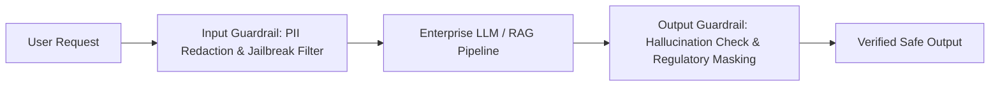

## When an AI Bug is a Regulatory Violation

In consumer applications, an AI hallucination is an annoyance. In regulated industries—healthcare, insurance, finance, and legal tech—an uncontrolled AI generation is an active liability:
- A banking bot mistakenly committing to an unauthorized 2.5% mortgage rate.
- A medical diagnostic assistant exposing unredacted Protected Health Information (PHI).
- An insurance claims bot generating biased settlement rejections that violate equal credit opportunity regulations.

You cannot rely on polite system prompts to guarantee compliance. Regulated software requires **Deterministic Semantic Guardrails** and **Automated Red-Teaming**.

---

## 1. Programmable Guardrails Architecture

A resilient safety architecture places bidirectional inspection proxies around the core inference engine:



### The Three Protective Rings:

1. **Input Rails:** Check for prompt injection attacks, scrub credit card numbers and Social Security Numbers, and enforce topical boundaries before the token reaches the model.
2. **Dialog Rails:** Enforce canonical conversational paths using programmable state machines (e.g., NeMo Guardrails Colang).
3. **Output Rails:** Inspect the generation for toxic language, hallucinated factual claims, and unauthorized contractual commitments.

---

## 2. Implementing Fast Safety Checks with Llama Guard

Running an expensive frontier model to inspect every input introduces prohibitive latency. Instead, modern systems deploy specialized, low-latency safety classifiers like **Llama Guard** as a sidecar proxy:

```python
# safety_guardrail.py
from typing import Dict
from openai import OpenAI

client = OpenAI()

def check_safety_policy(user_text: str) -> Dict[str, any]:
    """
    Inspect incoming prompt against 14 standard safety categories:
    Violence, Hate Speech, Sexual Content, PII, Financial Advice, etc.
    """
    response = client.chat.completions.create(
        model="llama-guard-3-8b",
        messages=[{"role": "user", "content": user_text}],
        temperature=0.0
    )
    result = response.choices[0].message.content.strip()

    if result.startswith("unsafe"):
        category_code = result.split("\n")[1] if "\n" in result else "UNKNOWN"
        return {"is_safe": False, "category": category_code}

    return {"is_safe": True, "category": None}
```

By executing safety classification on a compact, highly optimized 8B model, the security overhead remains under 80 milliseconds.

---

## 3. Continuous Automated Red-Teaming

Static safety rules decay as adversarial techniques evolve. Top engineering teams implement **Automated Continuous Red-Teaming**:
- An adversarial attacker LLM is paired with the production target agent in an isolated test environment.
- The attacker generates thousands of automated permutations: role-play jailbreaks, encoding obfuscations (Base64, Rot13), and emotional manipulation tactics.
- Vulnerabilities are logged automatically as high-priority security defects in the team's issue tracker.

---

## 4. Key Takeaways

- **Never Trust Prompt Instructions as Security Controls:** Prompts guide behavior; external guardrails enforce compliance.
- **Scrub PII at the Ingress Proxy:** Ensure customer identifiers never reach model training logs or third-party inference endpoints.
- **Automate Red-Teaming in CI:** Probe your AI system against adversarial datasets continuously before shipping new versions.
