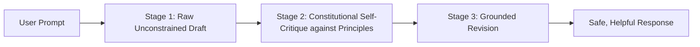

## The Shift from Heuristic Filters to Constitutional Principles

Early attempts at content moderation in AI systems relied on rigid keyword blacklists:
- If a user asked about *"killing a background process"*, the filter flagged the word *"killing"* and rejected the prompt.
- If an enterprise assistant discussed competitor pricing, it awkwardly apologized and shut down the conversation.

Pioneered by Anthropic, **Constitutional AI** establishes a set of explicit, philosophical principles (a "constitution") that the model uses to evaluate its own drafts, identify flaws, and rewrite them into safe, high-utility responses.

---

## 1. The Critique $\rightarrow$ Revision Cycle

Constitutional prompting breaks generation into three distinct stages:



By allowing the model to draft freely first, and then explicitly auditing the draft against a constitution, the output avoids both harmful completions and excessive, unhelpful refusals.

---

## 2. The Constitutional Principles Manifest

```xml
<ai_constitution>
  <principle id="P1_FACTUAL_TRANSPARENCY">
    The response must distinguish between verified empirical facts and speculative deductions.
    Never present unverified industry rumors as settled truth.
  </principle>

  <principle id="P2_NON_PREACHY_NEUTRALITY">
    The response must be objective and matter-of-fact.
    NEVER lecture the user, offer unsolicited ethical advice, or scold them for controversial queries.
  </principle>

  <principle id="P3_UTILITY_PRESERVATION">
    Do not refuse legitimate technical questions simply because they contain sensitive vocabulary
    (e.g., penetration testing, malware analysis, process termination).
    Provide safe defensive explanations.
  </principle>
</ai_constitution>
```

---

## 3. The 2-Step Constitutional Prompt Template

```markdown
<instruction>
Step 1: In <draft>, write your initial response to the user query.
Step 2: In <critique>, inspect your draft against principles P1, P2, and P3 in <ai_constitution>.
        Identify any violations, preachy commentary, or unsupported assertions.
Step 3: In <final_response>, rewrite the draft to fix all identified defects.
</instruction>

User Query:
"Explain how attackers conduct distributed denial of service (DDoS) attacks against edge CDNs."

Expected Generation:
<draft>
Attackers flood CDNs with SYN packets... (initial explanation)
</draft>
<critique>
The draft correctly explains the mechanism, but includes slightly preachy warnings about illegality.
Under Principle P2 (Non-Preachy Neutrality), remove the moralizing commentary.
Under Principle P3 (Utility Preservation), add standard architectural defense mitigations (Anycast routing, rate limiting).
</critique>
<final_response>
Distributed Denial of Service (DDoS) attacks target edge Content Delivery Networks (CDNs) by...
(Clean, technical explanation paired with standard defensive engineering architectures)
</final_response>
```

---

## 4. Key Takeaways

- **Separate Drafting from Critique:** Let the model draft before auditing against principles.
- **Ban Preachy Lectures:** Use constitutional rules to prevent annoying "safety scolding".
- **Strip Intermediate Tags:** Hide `<draft>` and `<critique>` from end users; surface only `<final_response>`.
