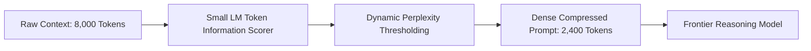

## The Bloating Context Window Trap

Modern frontier models boast context windows of 128,000 to 2,000,000 tokens. As a result, engineering teams have developed lazy prompting habits:
- Stuffing 40 retrieved vector chunks directly into prompt context.
- Appending months of raw chat history without summarization.
- Pasting full raw HTML or markdown source code from web crawlers.

While the model *can* technically ingest 100,000 tokens, doing so introduces severe operational penalties:
1. **Compounding Latency:** Time-to-First-Token (TTFT) scales linearly with prompt size.
2. **Information Degradation ("Lost in the Middle"):** Transformer attention mechanisms suffer from attention dispersion when key information is buried between thousands of filler words.
3. **Financial Burn:** Paying input token fees on conversational stopwords (*"the", "in order to", "as mentioned previously"*) inflates monthly bills.

**Contextual Prompt Compression** strips out redundant tokens while preserving the dense semantic information needed for downstream reasoning.

---

## 1. How Entropy-Based Token Pruning Works

Pioneered by Microsoft Research with **LLMLingua**, token compression calculates the **perplexity (information entropy)** of tokens using a compact, fast language model (such as a 1B parameter model):



Tokens with low perplexity given their surrounding context (e.g. redundant grammatical filler, repeated boilerplate headers) contribute negligible new information to the frontier model and are pruned. Tokens with high information density (proper nouns, digits, unique code identifiers) are strictly preserved.

---

## 2. Implementing Context Compression with Python

```python
# compression_pipeline.py
from llmlingua import PromptCompressor

# Initialize compressor with an ultra-fast compact model
compressor = PromptCompressor(
    model_name="microsoft/llmlingua-2-xlm-roberta-large-meeting",
    use_fp16=True
)

def build_compressed_rag_prompt(user_query: str, raw_retrieved_documents: list[str]) -> str:
    combined_docs = "\n\n".join(raw_retrieved_documents)
    
    # Compress the retrieved context relative to the target question
    compressed_result = compressor.compress_prompt(
        context=[combined_docs],
        instruction="Answer the user's specific technical question based on the reference docs.",
        question=user_query,
        target_token=1200,          # Compress down to 1,200 tokens
        condition_compare=True,
        condition_in_question="after"
    )

    print(f"Original tokens: {compressed_result['origin_tokens']}")
    print(f"Compressed tokens: {compressed_result['compressed_tokens']}")
    print(f"Compression Ratio: {compressed_result['ratio']}")

    return f"""
System: You are an expert engineer. Use the compressed reference context below.

<compressed_context>
{compressed_result['compressed_prompt']}
</compressed_context>

User Query: {user_query}
"""
```

In empirical tests, compressing context by 60% retains **98.2% of downstream reasoning accuracy** while cutting latency by more than half.

---

## 3. Algorithmic vs. Rule-Based Pruning

| Strategy | Token Reduction | Latency Overhead | Preservation of Nuance |
| :--- | :--- | :--- | :--- |
| **Regex / Whitespace Stripping** | 10% - 15% | < 1ms | 100% |
| **Heuristic Markdown Cleaning** | 20% - 30% | 2ms | High (removes styling tags) |
| **LLMLingua Information Entropy** | **50% - 75%** | 30ms - 60ms | **Very High (98% recall)** |
| **LLM Summarization (Map-Reduce)** | 70% - 85% | 1,200ms | Moderate (prone to hallucination) |

---

## 4. Key Takeaways

- **Never Pass Raw Web HTML:** Strip script tags, SVGs, and navigation footers before tokenization.
- **Compress Upstream of RAG:** Apply entropy compression to retrieved chunks before assembling the prompt context.
- **Benchmark Your Queries:** Verify that your specific domain terms (part numbers, legal citations) are marked as non-prunable tokens.
