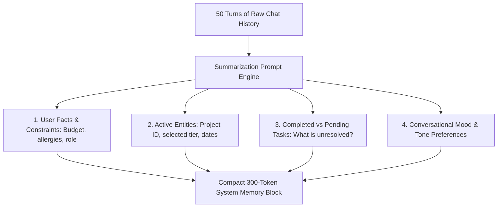

## The Multi-Turn Context Decay Problem

In conversational AI applications (virtual personal assistants, legal drafting bots, customer onboarding agents), conversations easily span 50 to 100 turns.

If you pass the entire raw conversation history on every request, two catastrophic failures occur:
1. **Context Window Exhaustion:** Latency spikes and token bills explode.
2. **Semantic Drift:** Important user constraints stated in Turn 2 (*"I am allergic to penicillin"* or *"Our corporate budget cap is \$5,000"*) get diluted and forgotten by Turn 40.

Naive summarization (*"Summarize the conversation so far"*) fails because it discards key technical entities in favor of vague prose.

**Lossless State Summarization** separates conversations into structured state entities and pending action items.

---

## 1. The Structured Conversational State Schema

Instead of generating a narrative paragraph, summarize conversation history into four explicit buckets:



---

## 2. The Incremental Memory Update Prompt

Run this prompt every 5 turns in the background to update the conversational state:

```xml
<memory_compactor>
  <previous_state>
    {EXISTING_JSON_STATE}
  </previous_state>

  <new_turns>
    {LAST_5_CONVERSATION_TURNS}
  </new_turns>

  <task>
    Update the previous state with new facts revealed in the new turns.
    Rules:
    - Never delete confirmed user constraints unless explicitly countermanded by the user.
    - If a pending task was completed, move it from "pending_tasks" to "resolved_tasks".
    - Track all named entities (phone numbers, account IDs, project names) verbatim.
    - Output strictly valid JSON conforming to <memory_schema>.
  </task>
</memory_compactor>
```

---

## 3. Assembling the Prompt Context for Turn N

At Turn 50, your agent prompt does not need 50 turns of history. It requires only:
1. The **Compact State Block** (300 tokens).
2. The **Last 3 Raw Turns** for conversational immediacy and natural cadence.

```typescript
// ai/chat-memory-assembler.ts
export function assembleContext(memoryState: object, recentTurns: Array<{ role: string; content: string }>) {
  return [
    {
      role: 'system',
      content: `Current User & Session State:
${JSON.stringify(memoryState, null, 2)}`,
    },
    ...recentTurns.slice(-4), // Only keep last 4 messages raw
  ];
}
```

This cuts token consumption by **85%** while guaranteeing that constraints established in Turn 1 are never forgotten.

---

## 4. Key Takeaways

- **Ditch Narrative Paragraphs:** Summarize conversations into structured JSON state objects.
- **Preserve Constraints Immutably:** User preferences and budget caps must persist across sessions.
- **Run Compaction Asynchronously:** Compress memory in background worker jobs without blocking user chat latency.
