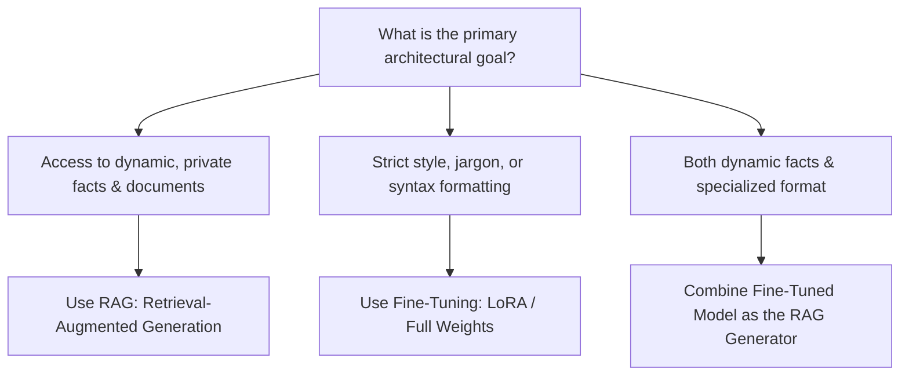

## The Enterprise Customization Conundrum

When leadership decides to implement generative AI, the first question in the architecture review is almost always:

> *“Should we fine-tune our own proprietary model on our internal company data?”*

Many organizations spend \$100,000 and three months fine-tuning an open-weight model on PDF documents, only to discover that the model still hallucinates quarterly revenue figures, cannot cite its sources, and must be completely retrained every time a policy changes.

Understanding the fundamental trade-offs between **In-Context Learning (Prompting)**, **Retrieval-Augmented Generation (RAG)**, and **Fine-Tuning (LoRA / QLoRA)** is critical for enterprise success.

---

## 1. Conceptual Separation: Form vs. Facts

The most important architectural heuristic is the distinction between **teaching form (behavior/style)** and **providing facts (knowledge/data)**:

- **Fine-Tuning modifies how the model acts:** It is designed for learning a specialized grammatical syntax, an internal API dialect, or a specific persona. It is notoriously terrible at memorizing volatile facts.
- **RAG modifies what the model knows:** It provides dynamic, authoritative context at runtime, with verifiable citations and instant updateability without retraining.

---

## 2. Quantitative Comparison Across Operational Dimensions

| Architectural Dimension | In-Context Learning (Prompting) | Retrieval-Augmented Generation (RAG) | Fine-Tuning (LoRA / SFT) |
| :--- | :--- | :--- | :--- |
| **Primary Use Case** | Prototypes & standard tasks | Dynamic factual queries | Complex formatting & domain style |
| **Data Volatility** | High (instant update) | High (instant index update) | Low (requires retraining pipeline) |
| **Hallucination Risk** | Moderate | **Lowest** (Grounded in context) | High (Parametric memory decays) |
| **Source Attribution** | N/A | **Verifiable citations** | Impossible (Black-box weights) |
| **Upfront Engineering Cost** | Hours (\$0) | Days (\$1k - \$5k) | Weeks (\$10k - \$50k) |
| **Per-Query Inference Cost** | High (large prompt tokens) | Moderate (retrieved chunks) | **Lowest** (terse prompts, smaller models) |

---

## 3. The Enterprise Adoption Recipe

At [renodotdev](https://renodotdev.com), we advise clients to follow a strict sequential escalation path:

1. **Phase 1: In-Context Learning:** Prototype using frontier models with comprehensive system prompts and dynamic few-shot exemplars. Validate product-market fit.
2. **Phase 2: Add RAG:** When documents exceed context limits or update frequently, implement vector search and knowledge graph indexing.
3. **Phase 3: Fine-Tune for Cost & Latency:** If you are spending \$20,000/month sending massive prompt instructions, fine-tune a compact 8B model (e.g. Llama 3 or Phi-4) on your verified input-output pairs to bake the instructions into the weights.

---

## 4. Key Takeaways

- **Never Fine-Tune for Knowledge Retrieval:** If your data changes weekly or requires exact citations, use RAG.
- **Fine-Tune to Cut Prompt Overhead:** Distill 2,000 tokens of system instructions into a compact model that requires only a 50-token prompt.
- **Combine RAG with Fine-Tuned SLMs:** The highest-efficiency enterprise architecture is a fine-tuned small model reading from a high-precision RAG index.
