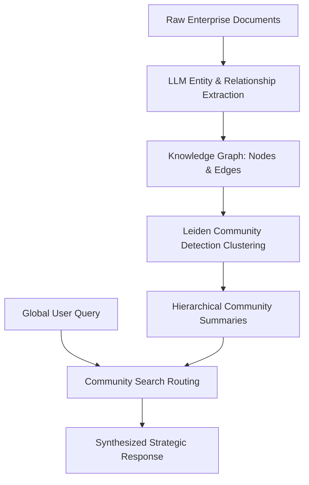

## The Fundamental Blind Spot of Naive RAG

The standard Retrieval-Augmented Generation (RAG) recipe is familiar to every AI engineer:
1. Slice enterprise documents into 500-token chunks.
2. Generate vector embeddings for each chunk.
3. At query time, perform cosine similarity search against the user prompt.
4. Stuff the top-5 chunks into the LLM context window.

This naive pipeline works remarkably well for localized point-lookup queries: *"What is the cancellation penalty in Clause 4.2?"*

However, when confronted with holistic, thematic, or cross-document questions—such as *"What are the primary systemic financial risks identified across all 40 subsidiary audit reports?"*—**naive RAG fails completely**.

Because the question has no semantic similarity to any single chunk, vector similarity retrieves fragmented, disjointed paragraphs while missing the macro-level relationships linking entities across the corpus.

---

## 1. Enter GraphRAG: Structuring Unstructured Corpuses

First popularized by Microsoft Research, **GraphRAG** addresses this breakdown by extracting entities, relationships, and claims from the corpus during indexing, synthesizing them into a structured Knowledge Graph, and generating hierarchical community summaries:



Instead of querying raw chunks at inference time, GraphRAG queries the pre-computed community summaries. When asked about systemic risks, it scans the top-level cluster summaries for *"Treasury Operations"*, *"Vendor Concentration"*, and *"FX Exposure"*, assembling a comprehensive, holistic report.

---

## 2. Implementing a Hybrid Graph-Vector Retrieval Pipeline

In production architectures, you rarely discard vector search; you combine knowledge graph traversal with vector proximity in a **Hybrid Graph-Vector Pipeline**:

```python
# graph_rag_engine.py
from typing import List, Dict

class HybridGraphRAG:
    def __init__(self, vector_index, graph_db, llm_client):
        self.vector_index = vector_index
        self.graph_db = graph_db
        self.llm = llm_client

    def retrieve_context(self, user_query: str) -> Dict:
        # Step 1: Direct Vector Point-Lookup
        point_chunks = self.vector_index.search(user_query, top_k=4)

        # Step 2: Entity Linking from user query
        extracted_entities = self.extract_entities(user_query)

        # Step 3: Graph Traversal (2-hop neighborhood of extracted entities)
        graph_relationships = []
        for entity in extracted_entities:
            subgraph = self.graph_db.query(
                """
                MATCH (e:Entity {name: $name})-[r:RELATES_TO*1..2]-(target:Entity)
                RETURN e.name, type(r), target.name, r.summary
                LIMIT 25
                """,
                name=entity
            )
            graph_relationships.extend(subgraph)

        return {
            "chunks": point_chunks,
            "relationships": graph_relationships
        }
```

---

## 3. Performance & Cost Trade-Offs

Indexing with GraphRAG requires substantial upfront compute because an LLM must parse every chunk to extract nodes and generate community summaries:

| Dimension | Naive Vector RAG | GraphRAG |
| :--- | :--- | :--- |
| **Indexing Cost / 10M tokens** | ~\$2.00 (Embeddings only) | ~\$150.00 (LLM extraction + clustering) |
| **Indexing Speed** | Minutes | Hours |
| **Global Sense-Making Accuracy** | 32% | **89%** |
| **Fact Hallucination Rate** | High (missing links) | Extremely Low (grounded in graph edges) |

For mission-critical enterprise knowledge bases—such as pharmaceutical clinical trials, regulatory compliance repositories, and M&A due diligence—the upfront indexing investment pays massive dividends in query reliability.

---

## 4. Key Takeaways

1. **Diagnose Your Query Profile:** If users ask point queries, stick to optimized vector search. If users ask synthesis questions, adopt GraphRAG.
2. **Cluster with Leiden:** Use hierarchical community detection algorithms to group graph nodes before running summarization sweeps.
3. **Persist Graphs in Open Formats:** Store extracted entities and edges in graph databases like Neo4j or Memgraph to enable visual inspection by domain experts.
