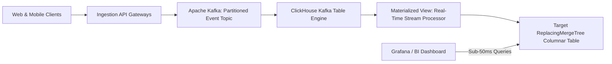

## When Traditional Databases Choke on Write Volume

When an engineering team builds an analytics dashboard for 100,000 monthly events, PostgreSQL or MySQL performs admirably. You write records to an `events` table and run `SELECT COUNT(*) GROUP BY category`.

When event volume reaches **100,000 events per second** (mobile telemetry, IoT sensor pings, ad clicks, financial order streams), row-oriented relational databases collapse:
- B-Tree index updates thrash disk I/O.
- Row-level lock contention halts ingestion pipelines.
- Disk storage balloons because uncompressed rows store massive redundant string headers.

Scaling high-throughput analytics requires a dedicated **Append-Only Columnar Architecture**: **Apache Kafka** for fault-tolerant ingestion buffering, paired with **ClickHouse** for ultra-fast analytical aggregation.

---

## 1. Architectural Blueprint: Kafka to ClickHouse



- **Apache Kafka:** Decouples ingestion spikes from database writes. If ClickHouse undergoes maintenance, Kafka buffers 48 hours of messages with zero data loss.
- **ClickHouse:** A column-oriented database designed specifically for Online Analytical Processing (OLAP). By storing data column by column with ZSTD compression, it compresses telemetry data by up to $90\%$ and scans billions of rows per second per server core.

---

## 2. ClickHouse Table Schema & Materialized Views

Here is a production ClickHouse schema for tracking user telemetry events:

```sql
-- 1. Target Columnar Table with MergeTree Engine
CREATE TABLE production.user_telemetry (
    event_time DateTime64(3, 'UTC'),
    tenant_id UUID,
    event_name LowCardinality(String),
    user_id String,
    device_os LowCardinality(String),
    response_time_ms UInt32,
    date Date MATERIALIZED toDate(event_time)
)
ENGINE = MergeTree()
PARTITION BY toYYYYMM(date)
ORDER BY (tenant_id, event_name, event_time)
SETTINGS index_granularity = 8192;

-- 2. Kafka Ingestion Consumer Engine
CREATE TABLE production.kafka_telemetry_stream (
    event_time DateTime64(3, 'UTC'),
    tenant_id UUID,
    event_name String,
    user_id String,
    device_os String,
    response_time_ms UInt32
)
ENGINE = Kafka
SETTINGS kafka_broker_list = 'kafka:9092',
         kafka_topic_list = 'telemetry-events',
         kafka_group_name = 'clickhouse-consumer-group',
         kafka_format = 'JSONEachRow';

-- 3. Materialized View Pipe (Pumps stream from Kafka into Target Table)
CREATE MATERIALIZED VIEW production.mv_telemetry_pipe TO production.user_telemetry AS
SELECT * FROM production.kafka_telemetry_stream;
```

---

## 3. Real-World Query Performance

Scanning 100 million rows in PostgreSQL:
```sql
SELECT event_name, AVG(response_time_ms) FROM user_telemetry GROUP BY event_name;
-- PostgreSQL: 42.8 seconds (Disk I/O bottleneck)
-- ClickHouse:  0.038 seconds (Vectorized CPU SIMD scan)
```

Because ClickHouse reads only the `event_name` and `response_time_ms` columns from disk (ignoring the other 10 columns entirely), query performance improves by orders of magnitude.

---

## 4. Key Takeaways

- **Never Use Row Databases for Heavy Analytics:** PostgreSQL is for OLTP (transactions); ClickHouse is for OLAP (analytics).
- **Partition by Month, Order by Query Keys:** Place `tenant_id` first in your `ORDER BY` tuple to enable instant partition pruning.
- **Batch Kafka Commits:** Always ingest events in batches rather than single-record transactions to maximize disk write throughput.
