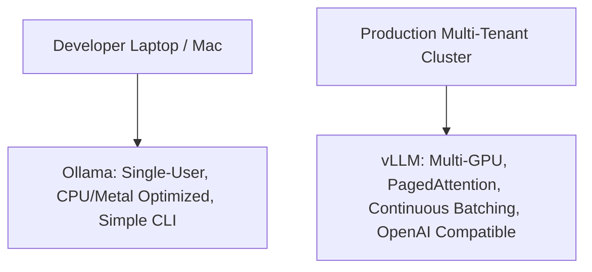

## When Cloud Inference is a Non-Starter

For many enterprise environments—defense contractors, biomedical research laboratories, and financial algorithmic desks—connecting an internal application to external cloud AI endpoints is strictly prohibited by security policy.

Furthermore, cloud inference creates unpredictable network latency dependencies and exposes teams to third-party outages and unannounced model checkpoint deprecations.

The open-source AI ecosystem has reached parity with commercial APIs for self-hosted execution. By pairing **vLLM** for high-throughput serving, **Ollama** for developer workstations, and **Open WebUI** for enterprise access control, teams can deploy a sovereign, air-gapped AI stack in hours.

---

## 1. Workstation vs. Production Cluster: Ollama vs. vLLM

Understanding when to use Ollama versus vLLM is fundamental:



- **Ollama:** Best for individual developer machines (macOS Apple Silicon, local laptops). It packages weights, prompt templates, and llama.cpp runtimes into single executable commands.
- **vLLM:** Designed for multi-tenant production clusters. Its breakthrough innovation—**PagedAttention**—manages GPU Key-Value memory like virtual memory pages in an operating system, eliminating memory fragmentation and boosting concurrency throughput by $10\times$ to $20\times$.

---

## 2. Production vLLM Deployment with Docker & GPU Pass-Through

Here is a hardened `docker-compose.yml` deploying an OpenAI-compatible vLLM inference server hosting Llama 3.1 8B Instruct with 4-bit AWQ quantization:

```yaml
# docker-compose.vllm.yml
version: '3.8'

services:
  vllm:
    image: vllm/vllm-openai:latest
    container_name: local-ai-inference
    restart: always
    environment:
      - HUGGING_FACE_HUB_TOKEN=${HF_TOKEN}
    command: >
      --model meta-llama/Llama-3.1-8B-Instruct
      --quantization awq
      --max-model-len 8192
      --gpu-memory-utilization 0.90
      --enforce-eager
      --port 8000
    deploy:
      resources:
        reservations:
          devices:
            - driver: nvidia
              count: all
              capabilities: [gpu]
    ports:
      - "8000:8000"
    volumes:
      - ./model-cache:/root/.cache/huggingface
```

Once running, any standard client library (OpenAI Python SDK, Vercel AI SDK, LangChain) connects directly by modifying `baseURL`:

```typescript
// client/local-ai.ts
import { OpenAI } from 'openai';

export const localAI = new OpenAI({
  baseURL: 'http://localhost:8000/v1',
  apiKey: 'EMPTY', // Local instance requires no remote token
});
```

---

## 3. Telemetry Isolation & Air-Gapping Checklist

To guarantee zero data egress in regulated environments:
1. **Disable Hugging Face Phone-Home:** Set `HF_HUB_OFFLINE=1` and pre-download weights to an internal S3/MinIO bucket.
2. **Container Network Isolation:** Bind the inference container to an internal bridge network with no external internet gateway.
3. **Audit Log Encryption:** Route Open WebUI conversation transcripts to an internal encrypted PostgreSQL database with automated 30-day retention pruning.

---

## 4. Key Takeaways

- **Use Ollama for Dev, vLLM for Prod:** Ollama provides frictionless developer UX; vLLM delivers enterprise continuous batching.
- **PagedAttention Multiplies Concurrency:** Standard inference runs out of VRAM at 4 concurrent requests; vLLM handles 60+ concurrent streams on the same hardware.
- **Sovereign AI Guarantees Compliance:** Zero prompt tokens or proprietary data ever leave your firewall.
