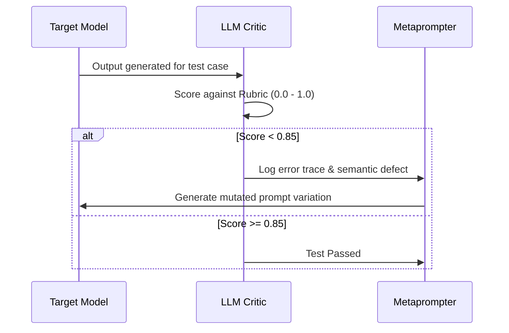

## The Limits of Manual "Vibe Tweaking"

Most developers optimize prompts through an intuitive, manual loop:
1. Write a prompt.
2. Test on 3 examples.
3. Notice a failure.
4. Add another paragraph of instructions: *"DO NOT FORGET TO..."*
5. Test again, only to discover that the fix broke 2 previously working examples.

This process is fundamentally unscientific. It treats prompt engineering as intuitive prose rather than an optimization problem with a quantifiable loss surface.

**Metaprompting** and **Algorithmic Prompt Optimization** invert this: you treat the prompt as a compilable parameter vector, using an LLM critic and a validation dataset to discover the highest-scoring prompt configuration automatically.

---

## 1. The Metaprompting Paradigm: LLMs Writing LLM Prompts

A metaprompt is a meta-level instruction template where an orchestrator model is instructed to generate, refine, and stress-test target system prompts based on objective failure logs:

```xml
<metaprompt_instruction>
  You are an expert prompt compiler.
  Below is an existing system prompt, a task description, and a set of failed inputs with bad outputs.
  
  Your goal:
  1. Identify why the current prompt failed on the edge cases.
  2. Rewrite the system prompt to prevent these failure modes.
  3. Ensure the rewritten prompt does not increase token length by more than 25%.
  4. Preserve all existing deterministic constraints.
</metaprompt_instruction>
```

By feeding an automated evaluator's test logs into the metaprompt loop, you can run overnight genetic optimization routines that evolve prompts against a golden dataset of 500 ground-truth examples.

---

## 2. DSPy: Compiling Prompts Rather than Writing Them

Stanford's **DSPy** framework formalizes this transition from manual string manipulation to programmatic optimization. Instead of hardcoding prompt strings, you define modular signatures and let teleprompter optimizers select the best few-shot exemplars and instruction phrasing:

```python
# dspy_pipeline.py
import dspy

# 1. Define input/output signature
class ClassifyCustomerIntent(dspy.Signature):
    """Classify customer support tickets into billing, technical, or account."""
    ticket_text = dspy.InputField(desc="Raw incoming customer email")
    sentiment = dspy.OutputField(desc="positive, neutral, or angry")
    category = dspy.OutputField(desc="billing, tech_support, or account_mgmt")

# 2. Build the Module
class SupportClassifier(dspy.Module):
    def __init__(self):
        super().__init__()
        self.prog = dspy.ChainOfThought(ClassifyCustomerIntent)

    def forward(self, ticket_text):
        return self.prog(ticket_text=ticket_text)

# 3. Optimize with BootstrapFewShot teleprompter
from dspy.teleprompt import BootstrapFewShot

def metric(gold, pred, trace=None):
    return (gold.category == pred.category) and (gold.sentiment == pred.sentiment)

teleprompter = BootstrapFewShot(metric=metric, max_bootstrapped_demos=4)
# compiled_classifier = teleprompter.compile(SupportClassifier(), trainset=train_data)
```

During compilation, DSPy systematically searches across candidate exemplars and synthesizes intermediate chain-of-thought steps that maximize the metric score. If you switch from Claude 3.5 Sonnet to GPT-4o-mini, you simply re-run `.compile()` to regenerate the prompt tuned for the new model's weights.

---

## 3. The LLM-as-a-Critic Architecture

To make metaprompting reliable, you need an objective evaluator (critic) that scores outputs against a rubric:



---

## 4. Engineering Takeaways

- **Stop manually rewriting strings** based on single-example failures.
- **Maintain a Golden Evaluation Set:** Curate 50-200 real user queries with expected outputs before modifying prompts.
- **Separate Prompt Architecture from Optimization:** Define functional signatures and let automated teleprompters assemble optimal few-shot exemplars.
