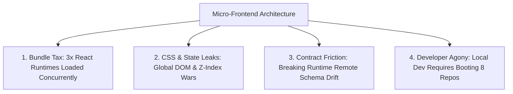

## The Allure of the Micro-Frontend Promise

Between 2021 and 2024, enterprise consulting firms aggressively pitched **Micro-Frontends** as the ultimate organizational savior:
- Split the monolithic frontend into 10 autonomous micro-applications.
- Team Checkout deploys independently from Team Catalog and Team Profile.
- Every team picks their own frameworks and deploys without coordinating with other squads.

On a PowerPoint slide, it sounds like organizational bliss.

In production engineering, however, dozens of Fortune 500 enterprises found themselves burdened by crippling technical debt: 15-megabyte page loads, cascading CSS namespace collisions, duplicated React runtimes, and impossible end-to-end integration testing.

Today, leading engineering organizations are making a decisive shift back toward **Well-Factored Modular Monoliths** powered by modern monorepo tooling.

---

## 1. The Hidden Costs of Micro-Frontends



1. **The Bundle Size Tax:** Even with Module Federation shared dependencies, differences in patch versions (`react@18.2.0` vs `react@18.3.1`) often cause the browser to download multiple copies of massive vendor libraries.
2. **Version Skew in Production:** Team Profile ships a breaking state shape to an internal event bus; Team Checkout crashes because their decoupled CI pipeline had no compile-time visibility into the change.
3. **Local Development Friction:** Running the application locally requires orchestrating 6 Docker containers, 4 micro-frontend proxies, and complex port forwarding.

---

## 2. The Modular Monolith Alternative

A **Modular Monolith** provides the organizational autonomy of micro-frontends without any of the runtime penalties:

```
apps/
  web/                     -> The single unified deployment target
packages/
  ui-components/           -> Shared design system
  checkout-feature/        -> Team Checkout domain logic & views
  catalog-feature/         -> Team Catalog domain logic & views
  analytics-core/          -> Shared telemetry contracts
```

By leveraging modern monorepo build tools (**Turborepo**, **Nx**, or **Bazel**):
- **Autonomous Ownership:** Teams own their distinct directory domains and review pull requests within their code boundaries using `CODEOWNERS`.
- **Compile-Time Type Safety:** If Team Catalog changes a TypeScript prop, every consuming view is checked at compile time across the entire monorepo.
- **Single Runtime:** The browser downloads exactly one optimized, tree-shaken JavaScript bundle.

---

## 3. Quantitative Decision Framework

| Evaluation Criteria | Micro-Frontends (Module Federation) | Modular Monolith (Turborepo / Nx) |
| :--- | :--- | :--- |
| **Ideal Team Size** | 300+ frontend engineers | 5 to 250 engineers |
| **Initial Page Load Performance** | Slow (Fragmented chunks) | **Fast** (Unified tree-shaking & preloading) |
| **Cross-Feature Refactoring** | High friction (Multiple repos) | **Frictionless** (Single atomic PR) |
| **CI/CD Build Times** | Fast per-service | **Fast** (Remote computation caching) |
| **Runtime Failure Mode** | Partial page white-screens | Predictable unified error boundaries |

---

## 4. Key Takeaways

- **Do Not Adopt Micro-Frontends for Tech Fashion:** Micro-frontends are an organizational coping mechanism for organizations with 500+ engineers, not a performance optimization.
- **Invest in Monorepo Tooling First:** Use Turborepo or Nx with boundary linters (`eslint-plugin-boundaries`) to enforce strict isolation between domains.
- **Optimize for End-User Performance:** End users do not care how your teams are organized; they care if the page loads in 200 milliseconds.
