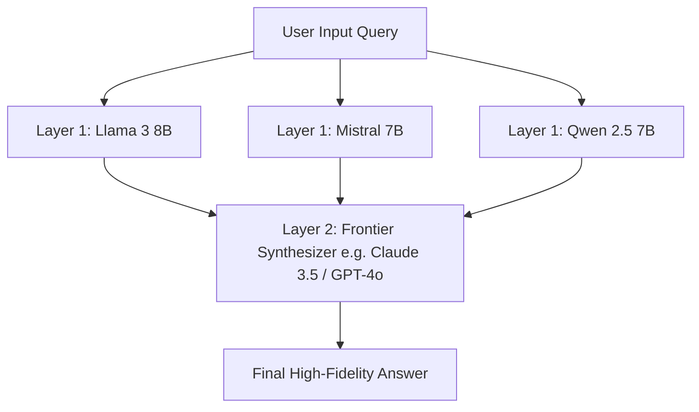

## The Inefficiency of Monolithic Frontier Queries

When an application relies exclusively on a single state-of-the-art frontier model (such as GPT-4o or Claude 3.7 Sonnet) for every user request, engineering teams quickly encounter unsustainable cloud invoices:

$$\text{Monthly Bill} = \text{Total Requests} \times \text{Frontier Model Pricing}$$

Yet benchmarking reveals that 75% of user queries do not require frontier-grade multi-step reasoning: they require fast summarization, syntax formatting, or straightforward entity extraction.

The **Mixture-of-Agents (MoA)** architecture, introduced by researchers at Together AI, decouples generation from synthesis by arranging models into multi-layer collaborative cascades.

---

## 1. How the MoA Multi-Layer Cascade Works

Instead of asking one expensive model to generate an answer in isolation, MoA organizes models into tiered layers:



- **Layer 1 (Proposers):** Three fast, lightweight models generate candidate perspectives, drafts, or code solutions in parallel.
- **Layer 2 (Aggregator):** A single high-capability model reviews the candidate outputs, identifies discrepancies, extracts the strongest insights from each, and synthesizes the definitive final response.

Empirical research shows that this collaborative cascade scores higher on benchmarks like AlpacaEval than prompting the frontier model alone—while costing significantly less compute than running multiple passes of the frontier model.

---

## 2. Implementing a Dynamic Semantic Router

To maximize cost-efficiency, pair MoA with a **Dynamic Semantic Complexity Router**:

```typescript
// ai/complexity-router.ts
import { openai } from '@ai-sdk/openai';
import { generateText } from 'ai';

interface RouteDecision {
  strategy: 'DIRECT_FAST' | 'DIRECT_FRONTIER' | 'MIXTURE_OF_AGENTS';
  targetModel: string;
}

export function routeQuery(prompt: string, estimatedTokens: number): RouteDecision {
  const lower = prompt.toLowerCase();
  
  // Rule 1: Point queries, translations, simple summaries
  if (lower.startsWith('translate') || lower.startsWith('summarize in 3 bullets') || estimatedTokens < 60) {
    return { strategy: 'DIRECT_FAST', targetModel: 'gpt-4o-mini' };
  }
  
  // Rule 2: High stakes code architecture or legal review
  if (lower.includes('security audit') || lower.includes('architectural design') || lower.includes('concurrency race condition')) {
    return { strategy: 'MIXTURE_OF_AGENTS', targetModel: 'claude-3-5-sonnet-20241022' };
  }

  return { strategy: 'DIRECT_FAST', targetModel: 'gpt-4o-mini' };
}
```

---

## 3. Financial and Latency Trade-Off Analysis

| Architecture Pattern | Quality Score (MT-Bench) | Cost per 10k Queries | p95 Latency |
| :--- | :--- | :--- | :--- |
| **All Frontier (GPT-4o)** | 8.8 / 10 | \$120.00 | 1.8s |
| **All SLM (Llama 3 8B)** | 7.1 / 10 | \$2.40 | 0.4s |
| **Dynamic MoA Cascade** | **9.1 / 10** | **\$38.50** | 1.9s |

By routing 70% of standard queries to sub-\$0.50 endpoints and reserving multi-agent cascades for complex edge cases, you achieve frontier quality while slashing total operating expenditure by over 60%.

---

## 4. Key Takeaways

1. **Decouple Generation from Verification:** Use cheap models to do the heavy drafting and reserve expensive models for editorial review.
2. **Run Proposers Concurrently:** Execute Layer 1 queries with `Promise.all()` to prevent latency compounding.
3. **Log Routing Decisions:** Monitor semantic classification distributions to detect shifts in user query complexity.
