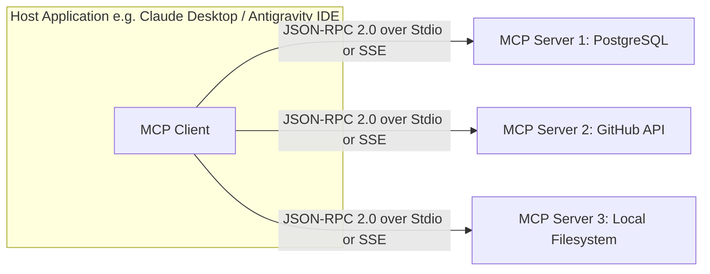

## The N×M Integration Nightmare

Before late 2024, integrating generative AI applications with external tools was a fragmented mess. Every developer tool, AI IDE, and enterprise agent framework invented its own proprietary tool-calling schema:
- LangChain had its tool abstractions.
- OpenAI introduced JSON function calling schemas.
- AutoGen and CrewAI had separate plugin systems.

If a developer built a Postgres database connector, they had to rewrite that connector $N$ times to support $M$ different AI clients.

**Model Context Protocol (MCP)**, open-sourced by Anthropic, resolves this fragmentation by establishing an open, universal standard for AI integrations—the same way the **Language Server Protocol (LSP)** revolutionized IDEs and language compilers a decade ago.

---

## 1. The MCP Architectural Topology

MCP defines a clean tripartite client-server model:



- **MCP Host:** The runtime application running the LLM (e.g., Claude Desktop, Antigravity IDE, Cursor).
- **MCP Client:** The internal subsystem within the Host that manages protocol connections to servers.
- **MCP Server:** A lightweight, isolated process that exposes three fundamental primitives:
  1. **Resources:** Read-only data sources (e.g. file contents, database tables, git diffs).
  2. **Prompts:** Pre-engineered prompt templates with parameterized arguments.
  3. **Tools:** Executable functions that cause side effects or execute queries.

---

## 2. Building a Custom MCP Server in TypeScript

Creating an enterprise MCP server is simple using the official `@modelcontextprotocol/sdk`. Here is a server exposing an internal company status API:

```typescript
// server/system-status-mcp.ts
import { Server } from '@modelcontextprotocol/sdk/server/index.js';
import { StdioServerTransport } from '@modelcontextprotocol/sdk/server/stdio.js';
import {
  CallToolRequestSchema,
  ListToolsRequestSchema,
} from '@modelcontextprotocol/sdk/types.js';

const server = new Server(
  { name: 'ops-status-server', version: '1.0.0' },
  { capabilities: { tools: {} } }
);

// 1. Register Available Tools
server.setRequestHandler(ListToolsRequestSchema, async () => {
  return {
    tools: [
      {
        name: 'get_service_health',
        description: 'Returns health status and active incident count for internal services.',
        inputSchema: {
          type: 'object',
          properties: {
            serviceName: {
              type: 'string',
              enum: ['auth', 'billing', 'inventory', 'search'],
            },
          },
          required: ['serviceName'],
        },
      },
    ],
  };
});

// 2. Handle Tool Invocation
server.setRequestHandler(CallToolRequestSchema, async (request) => {
  if (request.params.name === 'get_service_health') {
    const { serviceName } = request.params.arguments as { serviceName: string };
    const healthStatus = { status: 'OPERATIONAL', latencyMs: 24, incidents: 0 };

    return {
      content: [
        {
          type: 'text',
          text: JSON.stringify(healthStatus, null, 2),
        },
      ],
    };
  }
  throw new Error(`Tool not found: ${request.params.name}`);
});

// 3. Connect via Standard I/O Transport
const transport = new StdioServerTransport();
await server.connect(transport);
```

---

## 3. Security Boundaries & Sandboxing

Because MCP servers execute on local machines or inside internal VPCs, security boundaries are paramount:
- **Stdio Isolation:** MCP servers communicate over standard input/output (`stdio`), ensuring they have no direct network access unless explicitly granted.
- **Human-in-the-Loop Confirmation:** High-consequence tools (e.g. database drops, git pushes) require interactive user authorization prompts in the host UI before execution.
- **Principle of Least Privilege:** Read-only resources should be exposed via MCP Resources rather than executable Tools.

---

## 4. Key Takeaways

1. **Write Once, Run Everywhere:** Building an MCP server allows any MCP-compatible IDE or assistant to interact with your internal APIs immediately.
2. **Favor JSON-RPC 2.0:** Standardized message protocols eliminate bespoke schema conversion layers.
3. **Adopt MCP for Enterprise Workflows:** Expose internal documentation, database replicas, and telemetry dashboards as native MCP resources.
