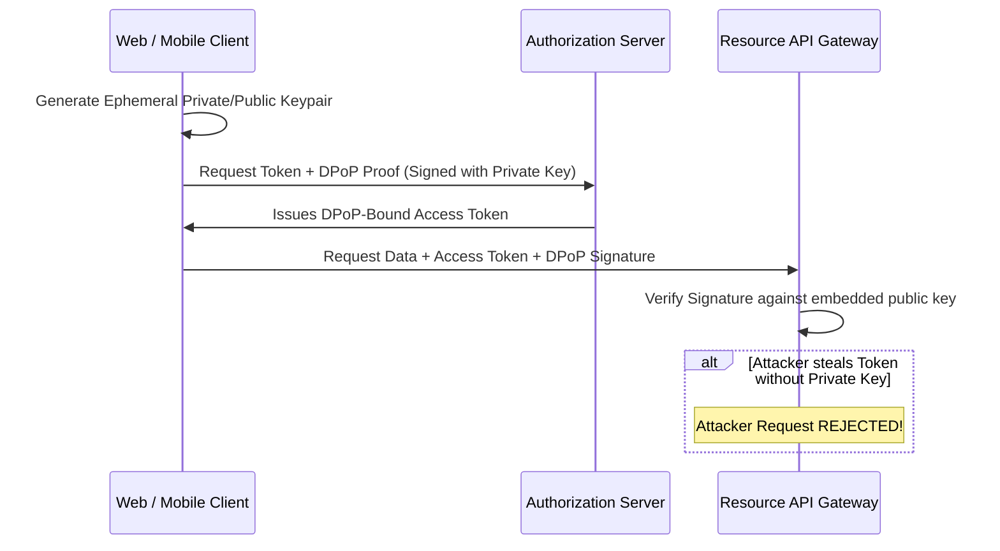

## Beyond Static Bearer Tokens

For a decade, standard API security consisted of passing a static Bearer token in the `Authorization` header:

```http
Authorization: Bearer eyJhbGciOi...
```

If an attacker intercepts this token—via cross-site scripting (XSS), misconfigured server logging, browser extension leakage, or man-in-the-middle proxies—they possess full, unrestricted access to the user's account until the token expires.

Modern API threat landscapes—fueled by automated botnets, credential stuffing attacks, and LLM-powered scraping spiders—require a **Zero-Trust API Security Architecture**.

---

## 1. OAuth 2.1 & Demonstrating Proof-of-Possession (DPoP)

OAuth 2.1 formalizes modern security best practices by deprecating insecure legacy flows (Implicit Grant, Resource Owner Password Credentials) and mandating **PKCE** (Proof Key for Code Exchange) for all clients.

The most critical breakthrough is **DPoP (RFC 9449)**: **Sender-Constrained Tokens**.



With DPoP, even if a bearer token is exfiltrated, it is **completely useless to an attacker** because they do not hold the private cryptographic key required to sign the per-request DPoP proof.

---

## 2. Dynamic Distributed Rate Limiting with Redis Sliding Windows

Fixed-window rate limiters (e.g. 100 requests per minute) are easily circumvented: an attacker sends 100 requests at 11:59:59 and another 100 at 12:00:01, creating a 200-request spike in 2 seconds.

Modern edge gateways implement **Redis Sliding Window Log** algorithms:

```typescript
// middleware/rate-limiter.ts
import { Redis } from '@upstash/redis';

const redis = new Redis({
  url: process.env.UPSTASH_REDIS_REST_URL!,
  token: process.env.UPSTASH_REDIS_REST_TOKEN!,
});

export async function checkRateLimit(
  clientIdentifier: string,
  limit: number = 60,
  windowSeconds: number = 60
): Promise<{ allowed: boolean; remaining: number }> {
  const now = Date.now();
  const clearBefore = now - windowSeconds * 1000;
  const key = `ratelimit:${clientIdentifier}`;

  // Execute atomic pipeline
  const pipeline = redis.pipeline();
  pipeline.zremrangebyscore(key, 0, clearBefore); // Remove old timestamps
  pipeline.zadd(key, { score: now, member: `${now}-${Math.random()}` }); // Add current ping
  pipeline.zcard(key); // Count active pings in current window
  pipeline.expire(key, windowSeconds);

  const results = await pipeline.exec();
  const currentCount = results[2] as number;

  const allowed = currentCount <= limit;
  return { allowed, remaining: Math.max(0, limit - currentCount) };
}
```

---

## 3. Mutual TLS (mTLS) for Internal Microservices

Securing public endpoints is only half the battle. Inside your internal cluster or VPC:
- Never transmit plain HTTP between microservices under the assumption that the internal network is trusted.
- Enforce **Mutual TLS (mTLS)** via service meshes (e.g., Istio or Linkerd): both the calling service and the receiving service verify each other's cryptographic X.509 certificates on every TCP handshake.

---

## 4. Key Takeaways

- **Adopt OAuth 2.1 and DPoP:** Prevent token exfiltration attacks by sender-constraining authentication tokens.
- **Use Sliding-Window Rate Limiting:** Enforce dynamic rate limits at the edge based on IP, user ID, and API key.
- **Assume Perimeter Breach:** Apply Zero-Trust internal mTLS encryption between all microservices.
