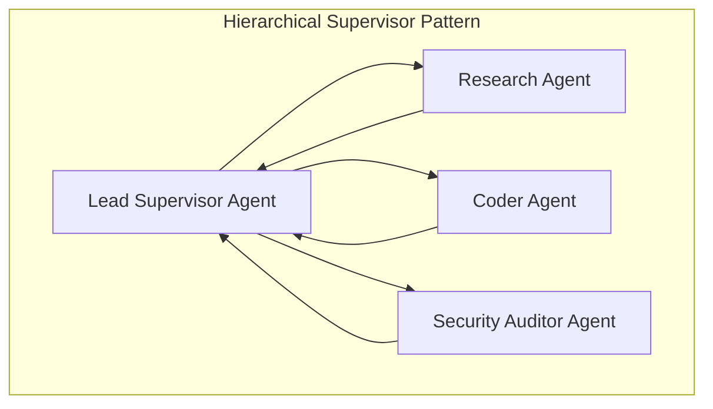

## The Limits of the Monolithic Agent

When building autonomous AI systems, initial prototypes typically rely on a single agent equipped with 15 different tools: database access, shell execution, web search, email sending, code execution, and CRM APIs.

In practice, this monolithic agent quickly collapses under its own cognitive weight:
- Tool selection accuracy drops exponentially as the number of available schemas exceeds 10.
- System instructions conflict: instructions for cautious legal review contradict instructions for aggressive code refactoring.
- Debugging is impossible: when an error occurs 8 steps into a 20-step trajectory, isolating which sub-decision failed is intractable.

The industry solution is **Multi-Agent Orchestration**: breaking complex workflows into specialized, role-bounded agents that collaborate via explicit state protocols.

---

## 1. Multi-Agent Topology: Hierarchical Supervisor vs. Peer Mesh

When designing a team of agents, your choice of communication topology dictates reliability and debugging complexity:



### The Hierarchical Supervisor Pattern (Recommended)
A central dispatcher agent receives user requirements, constructs an execution plan, assigns granular sub-tasks to specialized subagents, reviews their outputs, and manages state transitions. Subagents cannot talk to each other directly; they report only to the supervisor.

- **Pros:** Deterministic routing, straightforward logging, cycle prevention, predictable token budgets.
- **Cons:** Central supervisor is a potential reasoning bottleneck.

### The Peer-to-Peer Mesh Pattern
Agents post messages to a shared bulletin board or chat room, responding dynamically when another agent mentions their name.

- **Pros:** Flexible, emergent brainstorming.
- **Cons:** Prone to infinite conversational loops (*"Thanks!" / "You're welcome, anything else?"*), runaway token bills, and non-deterministic execution paths.

---

## 2. Production State Machines with LangGraph

Frameworks like **LangGraph** formalize multi-agent workflows as stateful, cyclical computation graphs:

```python
# langgraph_team.py
from typing import TypedDict, Annotated, List
import operator
from langgraph.graph import StateGraph, END

class AgentTeamState(TypedDict):
    task_description: str
    code_artifacts: Annotated[List[str], operator.add]
    review_status: str
    iterations: int

def coder_node(state: AgentTeamState):
    # LLM coder logic generates implementation
    new_code = "// Implemented feature"
    return {"code_artifacts": [new_code], "iterations": state["iterations"] + 1}

def reviewer_node(state: AgentTeamState):
    # LLM security auditor inspects code
    is_safe = state["iterations"] >= 2  # Simplified convergence condition
    return {"review_status": "APPROVED" if is_safe else "CHANGES_REQUESTED"}

def should_continue(state: AgentTeamState):
    if state["review_status"] == "APPROVED":
        return END
    if state["iterations"] >= 5:
        return END  # Safety Circuit Breaker
    return "coder"

# Construct Directed Graph
workflow = StateGraph(AgentTeamState)
workflow.add_node("coder", coder_node)
workflow.add_node("reviewer", reviewer_node)

workflow.set_entry_point("coder")
workflow.add_edge("coder", "reviewer")
workflow.add_conditional_edges("reviewer", should_continue, {END: END, "coder": "coder"})

app = workflow.compile()
```

By expressing agent handoffs as graph edges and maintaining an append-only state reducer, LangGraph provides deterministic checkpointing: if a node crashes, you can inspect the exact historical state snapshot and replay from that point.

---

## 3. Framework Showdown: LangGraph vs. CrewAI vs. AutoGen

| Capability | LangGraph | CrewAI | AutoGen |
| :--- | :--- | :--- | :--- |
| **Control Model** | Explicit State Graph (Cyclic) | Role-playing Crew / Tasks | Conversational Multi-party Chat |
| **State Persistence** | Native Postgres / SQLite Checkpoints | Ephemeral in-memory | Custom message history |
| **Production Readiness** | Highest (Strict control) | Medium (Great for rapid prototyping) | Medium (Research oriented) |
| **Learning Curve** | High (Requires graph mental model) | Low (Intuitive human team abstraction) | Moderate |

---

## 4. Engineering Takeaways

- **Isolate Roles Strictly:** Never give a single agent more than 4-6 tightly scoped tools.
- **Implement State Checkpointing:** Persist execution state between agent steps in Redis or PostgreSQL to enable pause/resume and human approvals.
- **Enforce Circuit Breakers:** Always bound the maximum number of multi-agent loops to prevent runaway cloud expenditures.
