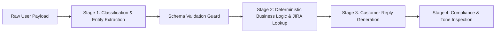

## The Fallacy of the All-in-One Prompt

When developers first design automated AI features, they often construct massive monolithic prompts that attempt to accomplish five tasks simultaneously:

> *"Analyze the attached customer feedback transcript, classify the sentiment, extract all named software bugs with severity ratings, map them to our internal JIRA component IDs, draft a polite customer reply, and format everything as a nested JSON object."*

This approach reliably fails in production. When you overload an attention window with multiple distinct cognitive operations, the model suffers from **attention dispersion**. It executes step 1 well, rushes through step 2, hallucinates JIRA components in step 3, and emits malformed JSON in step 5.

The solution is **Prompt Chaining**: decomposing a complex problem into a sequence of isolated, single-responsibility prompt nodes where the validated output of Node $N$ becomes the explicit input for Node $N+1$.

---

## 1. The Anatomy of a Deterministic Chain

A production prompt chain operates like an assembly line:



Every stage in the chain has three non-negotiable attributes:
1. **Single Cognitive Responsibility:** The prompt does exactly one thing (e.g. categorize, extract, synthesize, or critique).
2. **Strict Output Contract:** Each intermediate step produces structured, schema-validated data rather than conversational prose.
3. **Circuit Breaker:** If Stage 1 fails schema validation or flags the input as invalid, execution halts immediately before wasting tokens on Stages 2, 3, and 4.

---

## 2. Implementing a Type-Safe Chain in TypeScript

Here is a production pipeline built using the Vercel AI SDK and Zod:

```typescript
// pipelines/customer-feedback-chain.ts
import { generateObject, generateText } from 'ai';
import { openai } from '@ai-sdk/openai';
import { z } from 'zod';

// Step 1: Extraction Schema
const BugExtractionSchema = z.object({
  sentiment: z.enum(['positive', 'neutral', 'negative']),
  detectedBugs: z.array(z.object({
    feature: z.string(),
    severity: z.enum(['low', 'medium', 'high', 'critical']),
    description: z.string(),
  })),
  requiresImmediateReply: z.boolean(),
});

export async function processCustomerFeedback(rawTranscript: string) {
  // Stage 1: Pure Extraction (No writing, no formatting frills)
  const extractionResult = await generateObject({
    model: openai('gpt-4o-mini'),
    schema: BugExtractionSchema,
    system: 'Extract structured software issues from user feedback. Be objective and concise.',
    prompt: rawTranscript,
  });

  const { sentiment, detectedBugs, requiresImmediateReply } = extractionResult.object;

  // Circuit Breaker: If no bugs and sentiment is positive, route to standard thank-you
  if (detectedBugs.length === 0 && !requiresImmediateReply) {
    return { status: 'RESOLVED_NO_ACTION', bugs: [] };
  }

  // Stage 2: Synthesis & Customer Communication
  const replyResult = await generateText({
    model: openai('gpt-4o'),
    system: `You are an empathic, senior customer engineering specialist.
Draft a concise resolution email addressing specifically these extracted bugs:
${JSON.stringify(detectedBugs, null, 2)}
Never make false technical promises. Maintain a professional, reassuring tone.`,
    prompt: `Original customer message:
"${rawTranscript}"`,
  });

  return {
    sentiment,
    bugs: detectedBugs,
    customerReply: replyResult.text,
  };
}
```

---

## 3. Why Prompt Chaining Cuts Cloud Costs

It is a common misconception that multiple chained LLM calls cost more than a single massive prompt. In reality, prompt chaining often **reduces total inference expenditure by 50% to 70%**:
- **Model Right-Sizing:** Inexpensive, fast models (e.g. `gpt-4o-mini`, `claude-3-5-haiku`) handle early filtering and extraction stages at \$0.15/M tokens.
- **Selective Escalation:** Only the 15% of inputs requiring complex reasoning or creative writing ever reach expensive frontier models.
- **Early Exits:** Invalid, spam, or out-of-scope queries abort at Stage 1, incurring zero downstream costs.

---

## 4. Key Takeaways

- **One Task per Prompt:** Never ask a model to analyze, synthesize, and format simultaneously.
- **Validate at Every Boundary:** Use Zod schemas to ensure intermediate payloads are structurally sound before passing them downstream.
- **Use Tiered Models:** Run early extraction on sub-\$1 models and save frontier reasoners for final synthesis.
