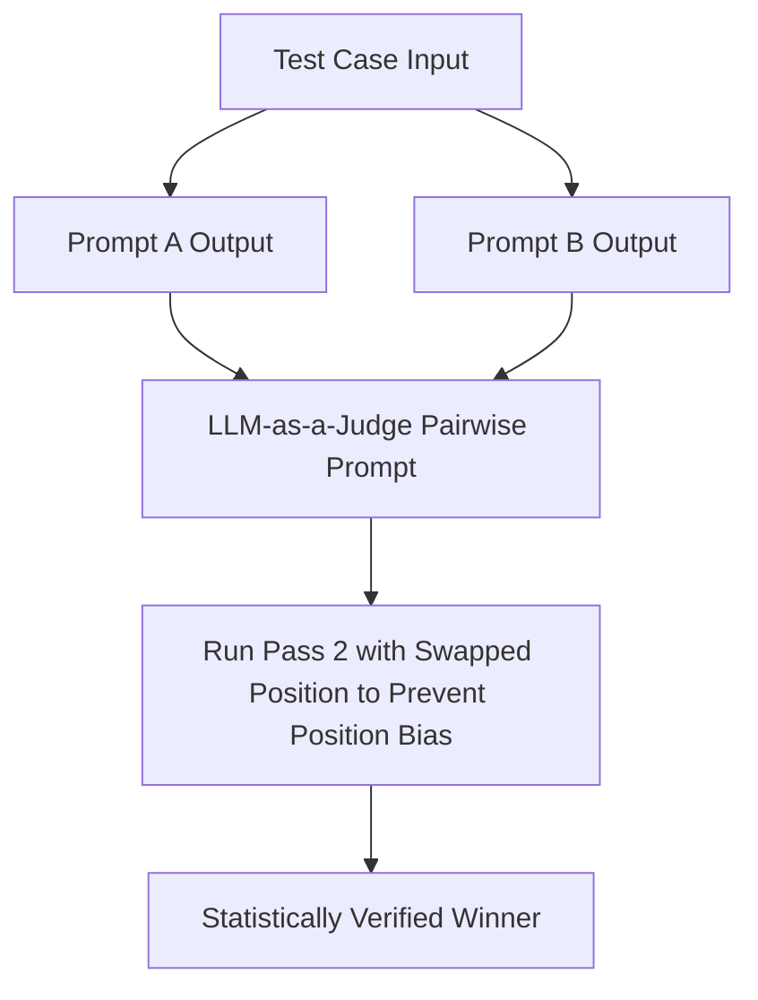

## The Subjectivity Trap in AI Quality Assessment

When engineering teams attempt to evaluate generative AI outputs, they frequently write vague judge prompts:
> *"Grade the assistant's answer from 1 to 5 based on how helpful and accurate it is."*

Without calibrated scoring criteria, LLM-as-a-judge evaluators exhibit catastrophic measurement drift:
- **Length Bias:** Models consistently award 5/5 to long, verbose answers even when shorter answers are more factually precise.
- **Self-Enhancement Bias:** GPT models give higher scores to GPT outputs; Claude models favor Claude formatting.
- **Score Clustering:** 95% of all outputs get graded a 4, making it impossible to detect subtle regressions in CI/CD.

To build reliable automated graders, you must design **Anchored 5-Point Rubrics** where every integer score is bound to concrete, falsifiable criteria.

---

## 1. Anatomy of an Anchored 5-Point Rubric

```xml
<evaluation_rubric metric="Technical Factual Accuracy & Hallucination Resistance">
  <score value="1" label="Critical Failure / Fabricated Fact">
    The response contains outright false technical claims, invents non-existent APIs,
    or contradicts verified ground-truth documentation in <reference_context>.
  </score>

  <score value="2" label="Major Inaccuracy / Incomplete">
    The response correctly identifies the core concept but provides dangerously flawed code,
    misses critical syntax invariants, or relies on deprecated APIs.
  </score>

  <score value="3" label="Partially Correct / Subtle Nuance Lost">
    The technical advice is functional and safe, but overlooks an explicit edge case
    or performance penalty explicitly mentioned in the user prompt.
  </score>

  <score value="4" label="Accurate & Complete">
    The answer is 100% factually accurate, addresses all constraints, and includes
    working, production-ready code with no hallucinations. Minor style nitpicks only.
  </score>

  <score value="5" label="Exemplary Engineering Standard">
    Flawless accuracy. In addition to answering the prompt completely, the response
    proactively anticipates real-world production failure modes, concurrency issues,
    or latency implications.
  </score>
</evaluation_rubric>
```

---

## 2. The Chain-of-Thought Verification Prompt

Never allow the evaluator model to emit a numeric grade first. If it writes `"Score: 5"` on token 1, it will rationalize that score in subsequent sentences regardless of defects.

Force the judge model to write its **Evidence Audit** before emitting the final integer:

```markdown
<instruction>
You are an impartial, highly skeptical code quality auditor.
Evaluate the candidate response against the reference documentation and scoring rubric.

Execution Order:
1. Inside <evidence_audit>, quote verbatim any discrepancies or claims not supported by the context.
2. Inside <rubric_mapping>, state which specific score definition (1, 2, 3, 4, or 5) matches the findings.
3. Inside <final_score>, output strictly the integer score.
</instruction>

Candidate Response:
{CANDIDATE_OUTPUT}

Reference Documentation:
{REFERENCE_DOCS}
```

---

## 3. Pairwise Evaluation: Overcoming Absolute Score Drift

When comparing whether Prompt Variation A is better than Prompt Variation B, absolute scoring often introduces noise. **Pairwise Comparison (A vs. B)** is far more consistent:



To eliminate **Position Bias** (the tendency to favor whichever option is presented first), always run the evaluation twice with the order swapped (A/B, then B/A). If the evaluator changes its vote when swapped, discard the result as a tie.

---

## 4. Key Takeaways

- **Define Concrete Anchors:** Never use abstract adjectives like "good" or "bad"; describe what physically happens in the code or text.
- **Audit Before Scoring:** Require the judge to cite evidence before choosing a numeric rating.
- **Swap Orders in Pairwise Evals:** Always test both orders to neutralize position bias.
