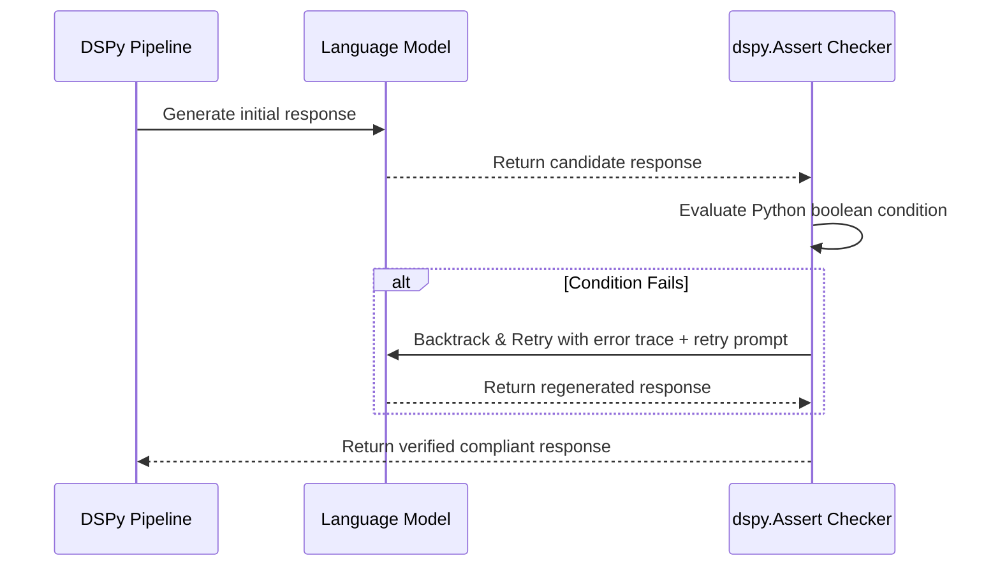

## Beyond Hope-Driven Prompting

Standard prompt engineering relies on hope: you write instructions, test a few inputs, and hope the model doesn't produce an invalid output in production.

When an invalid output occurs, developers typically add more text to the prompt: *"Make sure you never do X again."* This creates bloated prompts that still fail 3% of the time.

In traditional software, we don't "hope" code works; we write runtime assertions: `assert value > 0`.

Stanford's **DSPy** framework introduces **Runtime Assertions for LLMs** (`dspy.Assert` and `dspy.Suggest`): programmatic constraints that automatically intercept failed generations, provide diagnostic feedback to the model, and force an immediate self-healing retry.

---

## 1. How DSPy Assertions Work Under the Hood



Unlike static prompts that give up after one try, a DSPy assertion intercepts failures before the caller ever sees them.

---

## 2. Implementing dspy.Assert in Python

```python
# dspy_assertions_demo.py
import dspy

class GenerateProductCatalog(dspy.Signature):
    """Generate a marketing product entry for an e-commerce catalog."""
    product_name = dspy.InputField()
    target_demographic = dspy.InputField()
    ad_copy = dspy.OutputField(desc="Compelling product description under 80 words")
    call_to_action = dspy.OutputField(desc="Short button text")

class CatalogModule(dspy.Module):
    def __init__(self):
        super().__init__()
        self.prog = dspy.ChainOfThought(GenerateProductCatalog)

    def forward(self, product_name: str, target_demographic: str):
        prediction = self.prog(product_name=product_name, target_demographic=target_demographic)

        # Assertion 1: Word Count Constraint
        words = prediction.ad_copy.split()
        dspy.Assert(
            len(words) <= 80,
            f"Ad copy exceeded 80 words (received {len(words)} words). Compress it aggressively."
        )

        # Assertion 2: Prohibited Vocabulary Check
        banned_buzzwords = ["revolutionary", "groundbreaking", "seamless"]
        for word in banned_buzzwords:
            dspy.Suggest(
                word not in prediction.ad_copy.lower(),
                f"Avoid using overhyped corporate buzzword '{word}'. Use practical descriptors instead."
            )

        return prediction
```

### `dspy.Assert` vs. `dspy.Suggest`
- **`dspy.Assert` (Hard Failure):** If the condition is false, execution immediately backtracks. If it fails after $N$ retries, an exception is raised.
- **`dspy.Suggest` (Soft Guidance):** Encourages the model to retry if tokens allow, but permits execution to continue if the model struggles, preventing infinite loops.

---

## 3. Automated Prompt Compilation with Assertions

The true magic of DSPy happens during compilation:

```python
from dspy.teleprompt import BootstrapFewShotWithRandomSearch

teleprompter = BootstrapFewShotWithRandomSearch(
    metric=your_eval_metric,
    max_bootstrapped_demos=4,
    num_candidate_programs=8
)

# Compile optimizes both the prompts AND the retry strategies!
compiled_module = teleprompter.compile(CatalogModule(), trainset=train_data)
```

During compilation, DSPy saves only those execution traces that succeeded without triggering assertions, automatically assembling the perfect few-shot prompt.

---

## 4. Key Takeaways

- **Replace Textual Pleading with Runtime Assertions:** Stop writing *"Please keep it under 50 words"*; write `dspy.Assert(len(words) <= 50)`.
- **Self-Healing Retries:** DSPy feeds Python assertion failures directly back into the model's intermediate context.
- **Compile for Reliability:** Use teleprompters to assemble golden few-shot exemplars verified by assertions.
