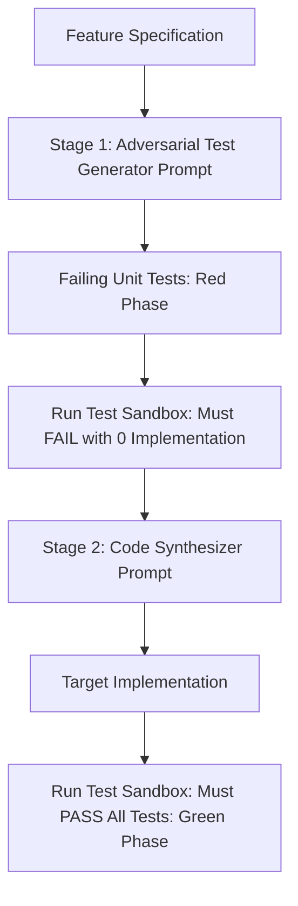

## The Circular Fallacy of Single-Prompt Code Generation

A common mistake among developers using AI coding assistants is asking the model to write both the implementation and its unit tests in the same prompt:
> *"Write a TypeScript function to parse JWT tokens and write the Vitest unit tests for it."*

When the same forward pass generates both code and tests, the model exhibits **circular confirmation bias**:
- If the implementation has a subtle bug (e.g. failing to verify token expiration times), the generated unit test will mirror that exact bug.
- The unit tests pass 100% of the time, giving engineers a false sense of security while deploying broken software to production.

The remedy is **Test-Driven Prompt Engineering (TDPE)**: decoupling test generation from code implementation into strict, adversarial phases.

---

## 1. The Two-Stage TDD Pipeline



In Stage 1, the test generator prompt knows *nothing* about how the function will be implemented. Its sole job is to act like a ruthless QA engineer: writing boundary tests, null inputs, expired tokens, malformed headers, and fuzz payloads.

---

## 2. Stage 1: The Adversarial Test Synthesizer Prompt

```xml
<test_generator_policy framework="Vitest">
  <objective>
    Write a comprehensive, standalone unit test suite for the specification in <feature_spec>.
    You are prohibited from providing the implementation code.
  </objective>

  <mandatory_test_cases>
    1. Happy Path: Canonical valid input.
    2. Null / Undefined / Empty Input handling.
    3. Boundary Values: Maximum length strings, numeric overflows.
    4. Adversarial Payloads: Expired timestamps, injection characters, unexpected types.
  </mandatory_test_cases>

  <mocking_rules>
    Mock all external network, database, or cryptographic dependencies using `vi.fn()`.
  </mocking_rules>
</test_generator_policy>
```

---

## 3. Stage 2: The Implementation Synthesizer Prompt

Once Stage 1 produces a valid, failing test suite, feed those exact test assertions to Stage 2:

```xml
<coder_policy language="TypeScript">
  <task>
    Write the production implementation code to satisfy the test suite below.
    Every single test assertion in <test_suite> MUST pass.
  </task>

  <rules>
    1. Do NOT modify or weaken the unit tests.
    2. Provide strictly the production function/class implementation.
    3. Include full TypeScript types, interfaces, and zero runtime 'any' castings.
  </rules>

  <test_suite>
    {TEST_CODE_FROM_STAGE_1}
  </test_suite>
</coder_policy>
```

---

## 4. Key Takeaways

- **Never Generate Tests and Code Together:** Decouple them to eliminate circular confirmation bias.
- **Verify the Red Phase First:** Ensure the generated unit tests actually fail before writing the implementation.
- **Prompt for Invariants:** Instruct the test generator to probe edge cases, timeouts, and negative scenarios.
