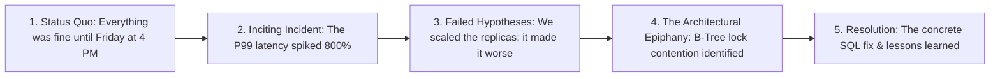

## The Plague of Bland AI Technical Content

Browse LinkedIn or engineering blogs today, and you will encounter hundreds of identical, robotic AI-generated posts:
> *"In today's fast-paced digital era, cloud computing is essential. Let's explore the top 5 game-changing benefits of Kubernetes..."*

They read like corporate brochures: zero narrative tension, zero concrete numbers, zero blood-and-guts production realities.

Authentic engineering writing is fundamentally **storytelling**: it has a protagonist (the engineering team), an antagonist (a looming deadline, a silent database deadlock, a catastrophic memory leak), a moment of crisis, an architectural epiphany, and empirical battle scars.

---

## 1. The Postmortem Narrative Arc

Great engineering case studies follow the classic dramatic structure:



---

## 2. The Technical Storytelling System Prompt

```xml
<editorial_specification>
  <voice_and_perspective>
    You are a battle-hardened senior systems engineer writing for an audience of principal architects.
    Perspective: First-person plural ("we", "our team") or authoritative third-person.
    Tone: Candid, pragmatic, slightly dry humor, zero marketing jargon.
  </voice_and_perspective>

  <narrative_structure>
    1. The Hook: Lead directly with the physical failure (e.g. "At 3:14 AM on Sunday, our Stripe webhook queue stalled...").
    2. The Red Herring: Document what the team *thought* was broken, and why that hypothesis was wrong.
    3. The Deep Dive: Show the actual code, flamegraph, or SQL EXPLAIN output that revealed the truth.
    4. The Takeaway Checklist: Actionable, bulleted rules other teams can implement tomorrow.
  </narrative_structure>

  <negative_constraints>
    - NEVER describe a technology as "revolutionary" or "game-changing".
    - NEVER start with an abstract dictionary definition ("Microservices are...").
    - NEVER skip concrete numbers (always include RPS, milliseconds, dollar costs, or CPU percentages).
  </negative_constraints>
</editorial_specification>
```

---

## 3. Grounding Prompts with Real Incident Logs

To make AI storytelling genuinely authentic, feed real terminal transcripts, error logs, or commit diffs into the prompt context:

```markdown
<incident_context>
Log excerpt:
`FATAL: remaining connection slots are reserved for non-replication superuser connections`
Time to resolution: 42 minutes.
Cause: Unpooled Lambda functions hammering Postgres during a product launch spike.
Fix: AWS RDS Proxy + PgBouncer setup with transaction-level pooling.
</incident_context>

Task:
Write a 1,200-word engineering postmortem based on the incident context above.
Follow the editorial specification. Include before-and-after architecture diagrams in Mermaid format.
```

---

## 4. Key Takeaways

- **Embrace Narrative Friction:** Engineering stories require real failure and struggle before the solution.
- **Ground with Concrete Artifacts:** Feed real error logs, flamegraphs, or SQL queries into the prompt.
- **Show the Numbers:** Quantify latency spikes, dollar costs, and throughput before and after the fix.
