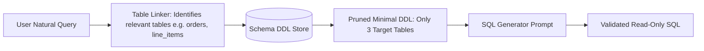

## The Danger of Naive Text-to-SQL

Building an AI assistant that answers natural language questions by querying internal databases is a dream for business leadership:
> *"What were our top 5 most returned products in Southeast Asia last quarter?"*

However, naive Text-to-SQL implementations frequently crash production databases:
- The model invents non-existent columns (hallucinating `orders.country` instead of joining `addresses.country_code`).
- It executes unindexed Cartesian product joins that lock tables and exhaust database memory.
- An adversarial prompt executes destructive statements: `DROP TABLE users;`.

Engineering enterprise Text-to-SQL requires disciplined **Schema Linking**, **Dialect Constraints**, and **Read-Only Sandboxing**.

---

## 1. Schema Linking: Minimal DDL Injection

Never dump your entire 200-table database schema into the system prompt. Storing 200 tables exceeds context budgets and confuses the model's attention mechanism.

Implement a **Schema Linking Pre-Filter**:



Pass only the pruned DDL schemas for the 3–5 relevant tables, complete with explicit **Foreign Key annotations**:

```sql
-- DDL Context provided to model:
CREATE TABLE customers (
    customer_id UUID PRIMARY KEY,
    company_name VARCHAR(255) NOT NULL,
    created_at TIMESTAMP WITH TIME ZONE NOT NULL
);

CREATE TABLE orders (
    order_id UUID PRIMARY KEY,
    customer_id UUID REFERENCES customers(customer_id), -- FK link
    total_amount_usd NUMERIC(12, 2) NOT NULL,
    status VARCHAR(50) NOT NULL -- ENUM: 'PENDING', 'PAID', 'REFUNDED'
);
```

---

## 2. Hardening the SQL Generation Prompt

```xml
<sql_generation_policy dialect="PostgreSQL 16">
  <operational_constraints>
    1. READ-ONLY MANDATE: Generate SELECT queries strictly.
       NEVER emit INSERT, UPDATE, DELETE, ALTER, DROP, or TRUNCATE.
    2. LIMIT GUARANTEE: Always append "LIMIT 100" unless an explicit aggregation (COUNT, SUM) is performed.
    3. NO UNINDEXED CARTESIAN JOINS: Every JOIN must feature an explicit ON clause binding matching keys.
    4. TIMEZONE DISCIPLINE: All date filtering must use UTC timestamps (`NOW() AT TIME ZONE 'UTC'`).
  </operational_constraints>

  <schema_alignment>
    - Never assume columns exist if not listed in <ddl_context>.
    - Refer to column descriptions for exact ENUM string values.
  </schema_alignment>

  <output_format>
    Emit the raw SQL query inside <sql_query> tags. Do not wrap in markdown quotes.
  </output_format>
</sql_generation_policy>
```

---

## 3. Defense-in-Depth: Database Read-Only Sandboxes

Never trust prompt constraints alone for security. At the database infrastructure layer:
1. **Dedicated Read-Only Role:** Connect the Text-to-SQL service using a PostgreSQL user with `GRANT SELECT` privileges exclusively.
2. **Statement Timeout:** Set `statement_timeout = '3000ms'` to kill queries that exceed 3 seconds of execution time.
3. **Pre-Execution SQL AST Parser:** Parse the generated string with an AST parser (such as `sqlparser`) in your backend code to verify that the query type is strictly `Select` before transmitting it to the database driver.

---

## 4. Key Takeaways

- **Prune Schemas Dynamically:** Feed only the relevant table DDLs rather than your entire database catalog.
- **Enforce Foreign Key Annotations:** Clearly indicate relation edges in the DDL to prevent bad joins.
- **Use Database-Level Enforcements:** Combine prompt rules with read-only database credentials and strict execution timeouts.
