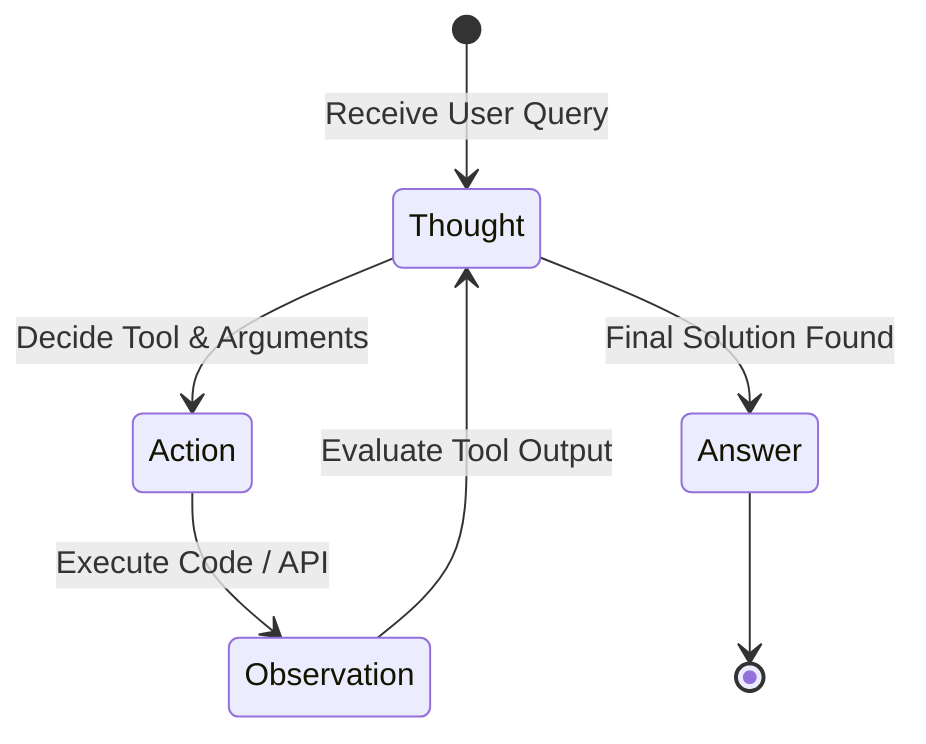

## Moving from Passive Responders to Active Problem Solvers

Traditional LLM interactions are strictly static: user provides input $\rightarrow$ model generates text. If the answer requires fresh data (e.g. checking a live Stripe subscription balance or querying a PostgreSQL replica), the model is blind.

The **ReAct** (Reasoning + Acting) paradigm, first introduced by Yao et al. (2022), creates an interleaved feedback loop where the model reasons about its current state, calls external functions, observes the tool's raw output, and iterates until it achieves its objective.

---

## 1. The Core ReAct Cycle: Thought $\rightarrow$ Action $\rightarrow$ Observation

Under the hood, a ReAct agent operates in a continuous loop:



- **Thought:** The model articulates what it knows and what information it is missing.
- **Action:** The model formats an invocation against a registered tool schema.
- **Observation:** The execution environment executes the call and injects the raw result back into the prompt context.

---

## 2. Crafting Tool Schemas for High Precision

Models do not understand the underlying implementation of your APIs; they rely solely on your JSON schema descriptions. Poorly documented arguments cause bad tool invocations.

### Good vs. Bad Tool Definitions

```json
// ❌ AMBIGUOUS SCHEMA
{
  "name": "lookup_user",
  "description": "finds a user",
  "parameters": {
    "type": "object",
    "properties": {
      "query": {"type": "string"}
    }
  }
}

// ✅ BULLETPROOF SCHEMA
{
  "name": "lookup_customer_by_identifier",
  "description": "Queries the CRM database for an existing customer. Returns customer ID, active subscription tier, and lifetime value.",
  "parameters": {
    "type": "object",
    "properties": {
      "identifier_type": {
        "type": "string",
        "enum": ["email", "phone_e164", "stripe_customer_id"],
        "description": "The type of identifier provided."
      },
      "value": {
        "type": "string",
        "description": "The exact identifier string. If phone, must be in E.164 format (+1...)."
      }
    },
    "required": ["identifier_type", "value"],
    "additionalProperties": false
  }
}
```

By constraining `identifier_type` to an enum and explicitly forbidding `additionalProperties`, you eradicate 90% of invalid tool calls.

---

## 3. Resilient Error Feedback Loops

When an external tool fails (e.g., database timeout or record not found), **never hide the error** behind a generic HTTP 500 error message. Feed the error back into the next Observation block so the model can self-correct:

```markdown
User: "Check billing status for user test@example.com"

Thought: I need to query the CRM for test@example.com.
Action: lookup_customer_by_identifier(identifier_type="email", value="test@example.com")
Observation: ERROR: CustomerNotFound: No record found with email test@example.com. Suggested actions: search by domain or check spelling.

Thought: The direct email lookup failed. I will check whether there is a company domain match or ask the user for clarification.
Action: search_customers_by_domain(domain="example.com")
```

When the prompt treats errors as diagnostic context, the agent acts like an autonomous engineer rather than a brittle script.

---

## 4. Preventing Infinite Loops & Budget Runaways

In production, agents can easily get trapped in endless loops: Tool A returns error $\rightarrow$ Model tries Tool A again $\rightarrow$ repeats until token budgets blow up.

Implement these three hard guardrails in your agent loop:
1. **Max Iteration Limit:** Set a hard cap (e.g., maximum 6 tool turns per user prompt).
2. **Duplicate Action Detector:** If the model proposes the exact same tool call with identical arguments consecutively, terminate the loop and escalate to human review.
3. **Cumulative Token Budget:** Track total tokens consumed across the multi-turn exchange and force a graceful degradation state if costs exceed \$0.10.
