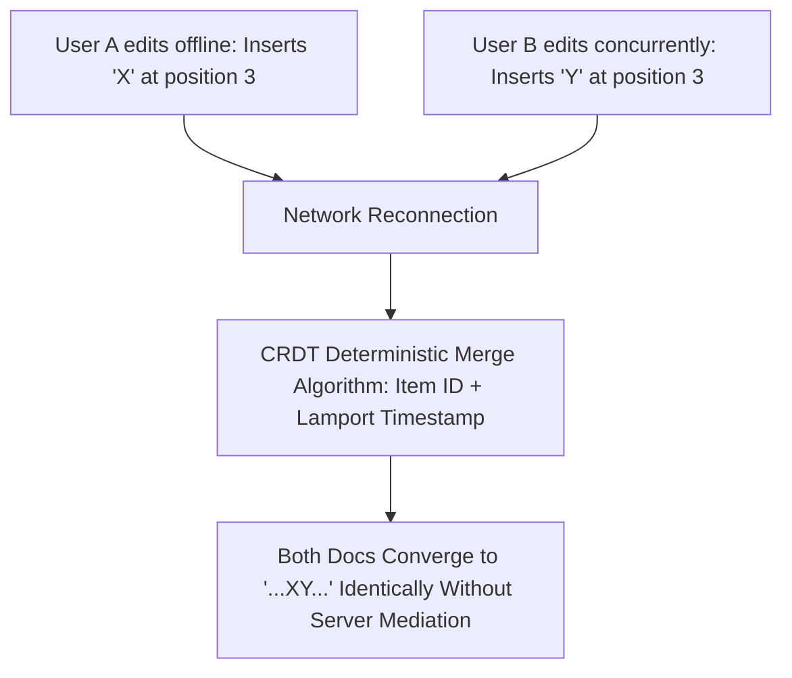

## The Multiplayer Web Expectation

From Figma and Google Docs to Notion and Miro, modern users expect digital workspaces to be natively multiplayer:
- Multiple users typing into the same document concurrently.
- Live user presence cursors gliding across the screen in real time.
- Instant offline editing on airplanes, with seamless automatic merging upon reconnecting without data loss.

Historically, collaborative software relied on **Operational Transformation (OT)**—the complex algorithm behind Google Docs. However, OT requires an authoritative central server to sequence every edit and is notoriously difficult to maintain in decentralized or peer-to-peer architectures.

Today, **Conflict-Free Replicated Data Types (CRDTs)** have superseded OT as the gold standard for real-time collaboration.

---

## 1. How CRDTs Eliminate Merge Conflicts

A CRDT is a distributed data structure that mathematically guarantees **Strong Eventual Consistency**: as long as all nodes receive the same set of updates (regardless of order or network latency), they will converge on the exact same internal state.



Instead of indexing characters by mutable array positions (which shift when edits occur), CRDTs assign every inserted character a unique, immutable cryptographic ID containing a Lamport timestamp and client identifier.

---

## 2. Implementing Collaborative Sync with Yjs & WebSockets

**Yjs** is the highest-performance CRDT framework in the JavaScript ecosystem. Here is how to synchronize collaborative state over WebSockets:

```typescript
// client/collab-editor.ts
import * as Y from 'yjs';
import { WebsocketProvider } from 'y-websocket';

// 1. Create a shared Yjs Document
const ydoc = new Y.Doc();

// 2. Connect to WebSocket room
const wsProvider = new WebsocketProvider(
  'wss://collab.yourdomain.com',
  'document-room-id-102',
  ydoc
);

// 3. Define shared collaborative types
const yText = ydoc.getText('content');
const awareness = wsProvider.awareness;

// Track collaborative cursor awareness
awareness.setLocalStateField('user', {
  name: 'Della Reno',
  color: '#a3e635', // Lime accent
  cursorPosition: { line: 12, ch: 4 },
});

// Listen for updates from remote peers
yText.observe((event) => {
  console.log('Document updated:', yText.toString());
});

// Perform local edit (automatically broadcasts binary diff to peers)
ydoc.transact(() => {
  yText.insert(0, 'Architecture Deep Dive: ');
});
```

---

## 3. Offline Persistence with IndexedDB

One of the greatest advantages of Yjs is native offline-first persistence. By attaching `y-indexeddb`, local changes are saved to browser storage instantly:

```typescript
import { IndexeddbPersistence } from 'y-indexeddb';

const indexeddbProvider = new IndexeddbPersistence('doc-offline-cache', ydoc);

indexeddbProvider.on('synced', () => {
  console.log('Local offline database loaded successfully!');
});
```

Even if the user loses internet connection for 3 days and makes 500 edits, when they reconnect, Yjs computes a compact binary delta and synchronizes with the server in under 50 milliseconds.

---

## 4. Key Takeaways

- **Choose CRDTs Over OT:** CRDTs eliminate server synchronization bottlenecks and make offline editing trivial.
- **Keep Awareness Ephemeral:** Do not persist user cursor positions into document history; keep them in ephemeral awareness channels.
- **Compact Historical States:** Periodically snapshot and garbage-collect older deletion tombstones to keep document memory footprints lean.
