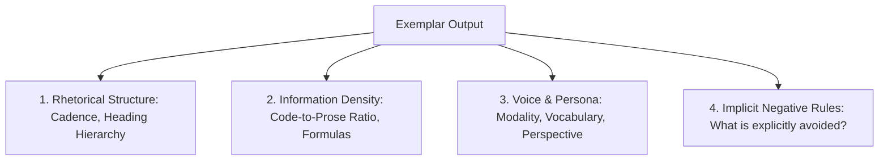

## The Art of Working Backward from Excellence

Often in product development, you stumble across a truly exceptional model output:
- A technical blog post with the exact right balance of engineering rigor and journalistic flair.
- An automated code review that accurately catches subtle concurrency bugs without false positives.
- A nuanced negotiation draft that strikes the perfect corporate tone.

Yet when you try to recreate that result with a basic prompt, the model reverts to generic, bland, or robotic outputs.

**Reverse Prompt Engineering** is the disciplined methodology of analyzing high-quality outputs, extracting the underlying latent constraints, structural patterns, and stylistic parameters, and compiling them into a reproducible, parameterized system template.

---

## 1. Deconstructing the Output Anatomy

To reverse-engineer an output, break it down across four structural vectors:



1. **Rhetorical Cadence:** Does the output lead with a strong problem statement? Does it alternate between prose paragraphs and technical tables?
2. **Information Density:** How many technical concepts are introduced per 100 words? Are arguments asserted or proven with concrete code examples?
3. **Voice & Stance:** Is the author active, authoritative, pragmatic, or academic?
4. **Negative Constraints:** What buzzwords (*"In today's fast-paced digital world"*, *"game-changer"*, *"delve"*) are conspicuously absent?

---

## 2. The Extraction Metaprompt

You can use an advanced frontier model to perform the linguistic deconstruction automatically:

```markdown
<reverse_engineering_prompt>
You are an expert prompt linguist and prompt architect.
Attached inside <target_output> is a world-class article on distributed systems architecture.

Your objective:
Reverse-engineer the exact system prompt, stylistic constraints, and few-shot guidance
required to reproduce this caliber of content consistently.

Output your analysis in four parts:
1. Persona & Tone Specification (Vocabulary tier, active vs passive voice, perspective).
2. Structural Template (Section-by-section outline with required components).
3. Explicit Negative Constraints (Things this author never does).
4. Parameterized Production System Prompt (Ready to paste into an API pipeline).
</reverse_engineering_prompt>

<target_output>
{PASTE_YOUR_EXCELLENT_OUTPUT_HERE}
</target_output>
```

---

## 3. Parameterizing the Extracted Template

Once the structural template is isolated, convert hardcoded artifacts into parameterized template variables:

```typescript
// templates/deep-dive-article.ts
export function createDeepDivePrompt(topic: string, codeLang: string, targetAudience: string): string {
  return `
You are a principal systems engineer writing an authoritative technical breakdown.

Target Topic: ${topic}
Primary Language: ${codeLang}
Audience: ${targetAudience}

Style Guide:
- Lead directly with the operational problem; no rhetorical questions or fluff introductions.
- Include at least one runnable code snippet demonstrating the core architectural pattern.
- Include a Markdown table comparing performance trade-offs.
- End with a numbered, concrete implementation checklist.

Negative Rules:
- NEVER use generic adjectives like "seamless", "cutting-edge", or "game-changing".
- NEVER summarize with "In conclusion" or "To sum up".
`.trim();
}
```

---

## 4. Key Takeaways

- **Collect Golden Exemplars:** Build an internal repository of exceptional outputs across each product domain.
- **Extract Implicit Negatives:** Great prompts are defined as much by what they prohibit as what they encourage.
- **Validate with Evals:** Test your reverse-engineered prompt against 20 new inputs to ensure it generalizes beyond the single original example.
