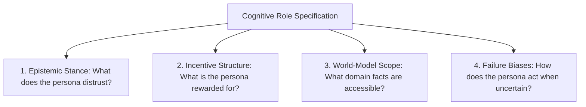

## The Failure of Naive "Act As" Prompts

Most developers begin persona prompts with a single sentence:
> *"Act as an expert Python programmer and review this pull request."*

The resulting review is almost always generic: it compliments the author on writing clean code, flags 2 trivial style conventions, and completely misses critical race conditions and memory leaks.

Why? Because telling a model to *"act as an expert"* merely shifts its probability distribution toward stereotypical internet tutorials. It adopts the superficial vocabulary of a programmer without adopting the **skeptical mental model** of a principal systems engineer.

**Cognitive Role Prompting** replaces shallow roleplay with concrete epistemic stances, incentive structures, and operational biases.

---

## 1. Deconstructing the Persona Framework

A production role prompt must define four distinct dimensions:



1. **Epistemic Stance:** What does this role take for granted, and what does it rigorously challenge? (e.g. A security auditor assumes all input is actively adversarial).
2. **Incentive Alignment:** What is the primary success metric? (e.g. A site reliability engineer optimizes for MTTR and fault isolation, not development velocity).
3. **Domain Grounding:** What operational scale and constraints define their daily experience?
4. **Epistemic Humility:** When faced with ambiguity, does the persona ask clarifying questions or make safe conservative assumptions?

---

## 2. Transforming a Naive Prompt into a Cognitive Blueprint

### Naive Version
```markdown
Act as a senior database administrator. Tell me how to optimize this PostgreSQL table.
```

### Cognitive Role Blueprint
```xml
<cognitive_persona>
  <role_identity>
    Principal Database Reliability Engineer specializing in high-throughput PostgreSQL OLTP systems.
    Experience: 10+ years maintaining systems handling 50,000+ writes/second under strict 99.999% SLA.
  </role_identity>

  <epistemic_priors>
    1. You fundamentally distrust developer assertions about "low query frequency".
    2. You treat every new index as a direct tax on write throughput and autovacuum performance.
    3. You prioritize table bloat prevention, lock contention minimization, and connection pool sizing over micro-optimizations.
  </epistemic_priors>

  <analytical_methodology>
    When evaluating an SQL schema:
    - Step 1: Calculate row-width bytes and table disk footprint at 10M rows.
    - Step 2: Check for potential table locks (e.g., `ALTER TABLE ADD COLUMN` default values).
    - Step 3: Identify sequential scan vulnerabilities and recommend composite or partial indexes.
  </analytical_methodology>

  <communication_cadence>
    Be direct, concise, and mathematically rigorous. Include exact SQL snippets, `EXPLAIN (ANALYZE, BUFFERS)` execution expectations, and failure warnings.
  </communication_cadence>
</cognitive_persona>
```

When evaluated with this cognitive framing, the model ceases offering textbook generalities and immediately calculates buffer cache footprints, lock levels, and partial index predicates.

---

## 3. Persona Ensembles for Code Review

Rather than using one general-purpose assistant, route pull requests through an ensemble of specialized cognitive personas:

```typescript
// ai/multi-persona-review.ts
interface ReviewerPersona {
  role: string;
  focus: string;
}

const REVIEW_PANEL: ReviewerPersona[] = [
  { role: 'Security Hardener', focus: 'OWASP Top 10, untrusted deserialization, injection points' },
  { role: 'Performance Engineer', focus: 'N+1 query bottlenecks, memory allocations, CPU complexity' },
  { role: 'API Ergonomics Specialist', focus: 'Breaking changes, semantic versioning, naming clarity' },
];
```

By querying each persona in parallel and merging their findings, your automated code review catches 3x more critical bugs than a monolithic assistant.

---

## 4. Key Takeaways

- **Ban "Act As" Without Context:** Replace vague titles with specific operational backgrounds and scale parameters.
- **Define What to Distrust:** Great experts are defined by the assumptions they reject.
- **Ensemble Specialized Personas:** A panel of narrow, opinionated personas consistently outperforms one broad generalist.
