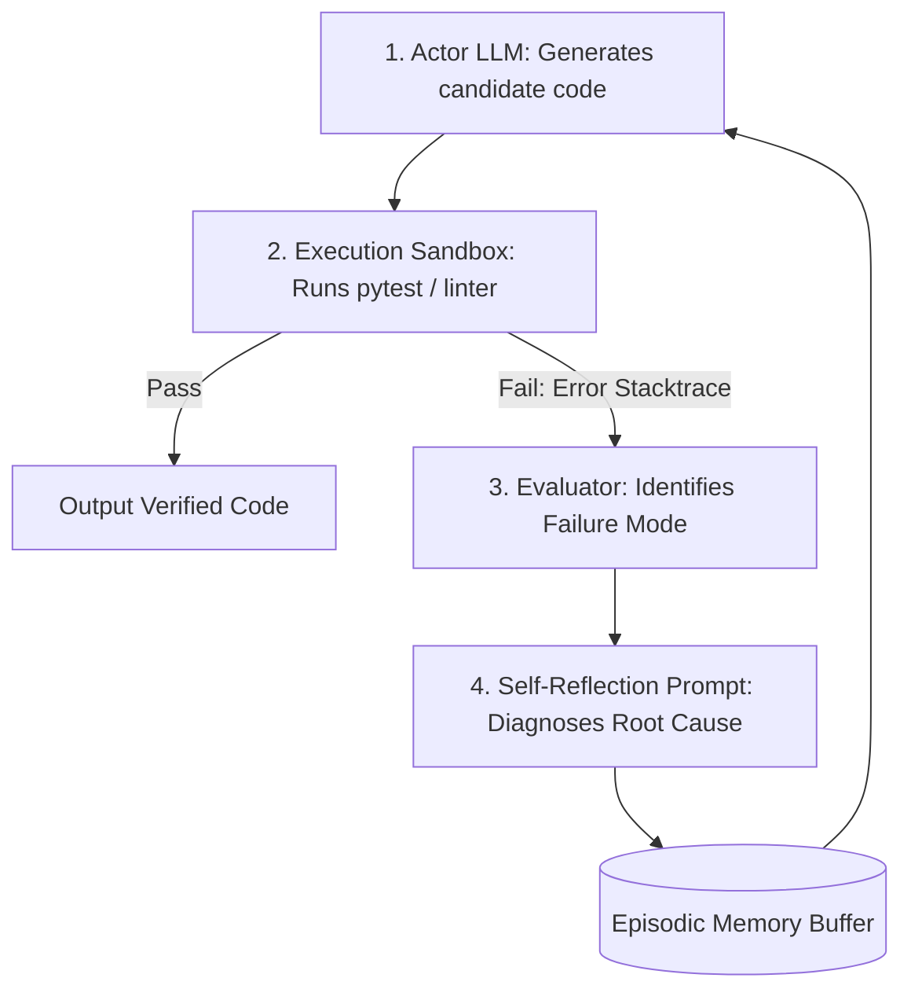

## When One-Shot Generation Fails

When human engineers write complex software, they rarely write working code on the first keystroke:
1. They write a first draft.
2. They run the unit test suite or compiler.
3. The compiler emits an error trace.
4. The engineer inspects the error, reflects on what went wrong, and adjusts the code.

Most LLM integrations, however, operate in a naive **One-Shot** mode: prompt $\rightarrow$ output. If the output has a subtle syntax error or fails a unit test, the pipeline simply crashes.

The **Reflexion** framework, developed by Shinn et al. at MIT and Princeton, formalizes self-reflection: giving the agent an **episodic memory buffer** to inspect its own failure traces and dynamically revise its strategy.

---

## 1. The Reflexion Feedback Loop Architecture



- **Actor:** Proposes an action or code implementation.
- **Environment:** Runs the candidate code in an isolated sandbox and returns the stdout, stderr, or unit test assertion failure.
- **Self-Reflection Node:** Generates a short, verbal reflection: *"My implementation failed because I forgot to handle null values in the JSON array."*
- **Memory Buffer:** Stores historical reflections and injects them into the prompt for the next attempt.

---

## 2. Crafting the Self-Reflection Prompt

When an execution failure occurs, the reflection prompt must force root-cause analysis rather than superficial apologies:

```xml
<reflection_instruction>
  You are an expert software engineer analyzing a failed code execution attempt.

  Previous Attempt:
  {PREVIOUS_CODE}

  Execution Output / Test Failure:
  {RAW_ERROR_STACKTRACE}

  Your Task:
  Write a concise reflection diagnosing exactly why the previous implementation failed.
  Format your reflection in 3 bullet points:
  1. Root cause of the failure.
  2. The faulty assumption in the previous code.
  3. Concrete corrective strategy for the next attempt.

  Do NOT write new code in this step; focus purely on diagnosing the failure.
</reflection_instruction>
```

---

## 3. Implementing the Reflexion Loop in Python

```python
# reflexion_loop.py
from typing import List

class ReflexionAgent:
    def __init__(self, code_llm, reflection_llm, test_runner):
        self.code_llm = code_llm
        self.reflection_llm = reflection_llm
        self.test_runner = test_runner
        self.memory: List[str] = []

    def solve(self, task_description: str, max_trials: int = 4) -> str:
        for trial in range(1, max_trials + 1):
            print(f"--- Running Trial {trial} ---")

            # 1. Generate code with injected memory reflections
            code = self.code_llm.generate(
                task=task_description,
                past_reflections=self.memory
            )

            # 2. Execute code in isolated test runner
            test_passed, error_log = self.test_runner.run(code)
            if test_passed:
                print("Tests Passed! Solution converged.")
                return code

            # 3. Reflect on failure and store in memory
            reflection = self.reflection_llm.reflect(
                task=task_description,
                code=code,
                error=error_log
            )
            self.memory.append(reflection)
            print(f"Stored Reflection: {reflection}")

        raise RuntimeError("Agent failed to converge within maximum trials.")
```

On benchmark datasets like HumanEval, adding this reflective feedback loop elevates problem-solving accuracy from 68% to **91%**.

---

## 4. Key Takeaways

- **Separate Reflection from Re-Coding:** Ask the model to analyze *why* it failed before asking it to write new code.
- **Maintain an Episodic Memory Buffer:** Inject historical trial reflections so the agent doesn't repeat previous mistakes.
- **Cap Maximum Trials:** Always bound the loop to 3–5 attempts with strict circuit breakers.
