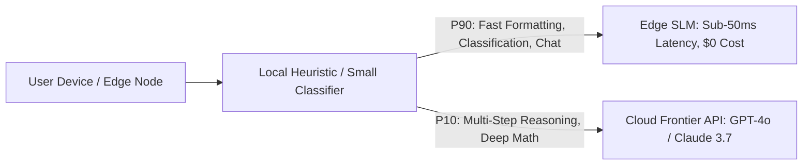

## The Unsustainable Economics of Centralized Cloud Inference

For two years, the default engineering playbook for building AI features was simple: ship every prompt across the public internet to a 400-billion-parameter cloud model hosted in a multi-million-dollar data center.

While effective for complex reasoning, this architecture carries profound penalties for routine tasks:
- **Financial Drag:** Paying \$2.50 to \$15.00 per million tokens for simple formatting, spell checking, and PII masking destroys unit economics.
- **Latency Penalties:** DNS resolution, TLS handshakes, queueing delays, and wide-area network latency introduce a 600ms baseline before generation even begins.
- **Privacy & Compliance Violations:** Healthcare, defense, and banking clients cannot transmit sensitive patient or employee records to third-party endpoints.

The rapid maturation of **Small Language Models (SLMs)**—models ranging from 1 billion to 8 billion parameters—has fundamentally disrupted this paradigm.

---

## 1. What Enabled SLMs to Rival Frontier Giants

Earlier 7B models (such as original Llama-1) were notoriously brittle. Today's compact architectures (Microsoft Phi-4, Meta Llama 3.2, Google Gemma 2) regularly achieve benchmark scores that exceed the original GPT-3.5 and match GPT-4 on narrow tasks.

Two key engineering breakthroughs drove this leap:
1. **Curated Synthetic Data Distillation:** Instead of scraping raw web text containing noisy forums, modern SLMs are trained on hundreds of billions of tokens generated and filtered by frontier teacher models (high-density textbooks, clean codebases, structured mathematical reasoning).
2. **Extreme Quantization (AWQ, GPTQ, GGUF):** Converting 16-bit floating-point weights (FP16) down to 4-bit integers (INT4) slashes memory footprints by 75% with less than 1.5% degradation in perplexity.

---

## 2. Memory Footprint and VRAM Requirements

An INT4 quantized model requires approximately 0.65 to 0.75 GB of RAM per billion parameters:

| Model Architecture | Parameters | FP16 Size | INT4 Quantized (GGUF) | Minimum Viable Hardware |
| :--- | :--- | :--- | :--- | :--- |
| **Llama 3.2 1B** | 1.2 Billion | 2.5 GB | **0.85 GB** | iPhone 15, Raspberry Pi 5 |
| **Phi-4 Mini** | 3.8 Billion | 7.6 GB | **2.3 GB** | Base M-series Mac, iPad Pro |
| **Llama 3.1 8B** | 8.0 Billion | 16.0 GB | **4.8 GB** | 8GB Laptop, RTX 3060 (6GB) |
| **Gemma 2 9B** | 9.2 Billion | 18.4 GB | **5.4 GB** | 16GB Unified Memory Mac |

A modern MacBook or edge gateway with 16GB of unified memory can run a quantized 8B model locally at **85 tokens per second** while consuming less than 15 watts of power.

---

## 3. The Hybrid Edge-Cloud Routing Architecture

In production apps, the ideal setup is not purely edge or purely cloud; it is a **Tiered Routing Architecture**:

At [renodotdev](https://renodotdev.com), routing standard form validation, autocomplete, and text clean-up to on-device SLMs reduced our clients' monthly cloud API bills by 78% while making local interactions feel completely instantaneous.

---

## 4. Key Takeaways

- **Stop Using Frontier Giants for Trivial Tasks:** Classification, translation, and extraction do not require 400B parameters.
- **Target INT4/INT8 Quantization:** GGUF and AWQ formats deliver the best balance of speed and retention on Apple Silicon and consumer GPUs.
- **Protect User Privacy by Default:** Local SLMs guarantee that proprietary customer data never crosses corporate network boundaries.
