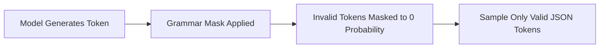

## The Breakdown of Natural Language Formatting

Every software engineer building on top of generative AI has experienced this runtime crash:

```
SyntaxError: Unexpected token '`', "```json
{..." is not valid JSON
    at JSON.parse (<anonymous>)
```

You wrote in your prompt: *"Output strictly pure JSON with no markdown and no conversational preamble."*

Yet at 2:00 AM on Sunday, the model decides to respond:
```
Sure! Here is the JSON data you requested:
```json
{
  "orderId": 10923,
  // Note: customer requested rush shipping
}
```
```

Natural language instructions cannot guarantee syntactic determinism. When models generate tokens based on probabilistic token distributions, trailing comments, missing quotes, or markdown wrappers are statistically inevitable.

---

## 1. How Constrained Decoding Eliminates Schema Violations

The modern solution to this problem is **Constrained Decoding** (also known as Grammar-Guided Sampling).

Instead of letting the model sample freely from its entire 100,000-token vocabulary, the inference engine builds a finite state machine (FSM) or context-free grammar directly from your JSON Schema:



If the grammar expects a closing brace `}` or a comma `,`, tokens representing letters or markdown backticks have their logit probabilities mathematically forced to $-\infty$.

**It is mathematically impossible for the output to violate the schema.**

---

## 2. Implementing Native Structured Outputs with Zod & AI SDK

In TypeScript applications, pairing native provider Structured Outputs with **Zod** gives you end-to-end type safety from prompt generation to database write:

```typescript
// lib/extract-contract.ts
import { generateObject } from 'ai';
import { openai } from '@ai-sdk/openai';
import { z } from 'zod';

export const LegalClauseSchema = z.object({
  clauseId: z.string().describe("Standardized identifier e.g. CLAUSE-INDEMNITY-01"),
  riskLevel: z.enum(["LOW", "MEDIUM", "HIGH", "CRITICAL"]),
  summary: z.string().max(200),
  obligations: z.array(z.string()),
  monetaryCapUsd: z.number().nullable().describe("Explicit dollar liability cap, or null if uncapped"),
});

export async function parseContractClause(clauseText: string) {
  const { object } = await generateObject({
    model: openai('gpt-4o'),
    schema: LegalClauseSchema,
    schemaName: 'LegalClause',
    schemaDescription: 'Structured risk breakdown of commercial contract clauses',
    prompt: `Analyze the following contract excerpt:

${clauseText}`,
  });

  // object is strictly typed as z.infer<typeof LegalClauseSchema>
  return object;
}
```

---

## 3. When to Choose XML Over JSON

While JSON is the industry standard for programmatic data exchange, **XML formatting is superior for human-in-the-loop and streaming workflows**:

| Dimension | JSON Schema | XML Delimiters |
| :--- | :--- | :--- |
| **Streaming UI Parseability** | Difficult (syntax invalid until closing braces) | Easy (opening tag `<summary>` can stream immediately) |
| **Token Overhead** | High (frequent quotes, commas, brackets) | Low (clean semantic tags) |
| **Complex Nested Text** | Escaped newlines (`\n`) and quotes (`\"`) | Raw multiline text without escaping |
| **API Integration** | Native native compatibility | Requires string parsing |

---

## 4. Key Takeaways

1. **Never parse unconstrained LLM responses with `JSON.parse`** without a fallback repair layer or schema validator.
2. **Use Provider-Level Structured Outputs:** OpenAI's `response_format: json_schema` and Anthropic's tool-based schemas mathematically eliminate syntax errors.
3. **Combine Zod with Runtime Validation:** Ensure full TypeScript inference so downstream database handlers remain type-safe.
