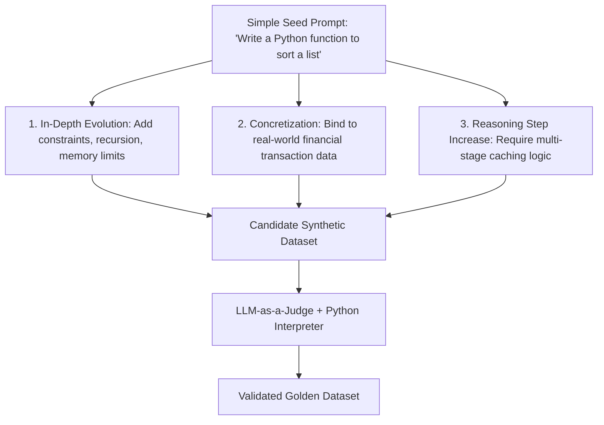

## The "Data Wall" Crisis in Artificial Intelligence

The global artificial intelligence industry is rapidly hitting what researchers call the **Data Wall**: human society produces a finite amount of high-quality public text per year, and frontier models have already ingested virtually all public books, academic papers, and Wikipedia articles.

Scraping deeper into web comment sections yields diminishing returns and degrades model alignment. Furthermore, enterprise teams building specialized internal models face a different hurdle: their proprietary domain knowledge (e.g., proprietary semiconductor diagnostic manuals or closed-source trading algorithms) has zero public training data available.

**Synthetic Data Engineering**—the programmatic generation, filtration, and verification of machine-generated datasets—has become the primary driver of performance gains in modern model development.

---

## 1. The Evol-Instruct Methodology

Pioneered by WizardLM, **Evol-Instruct** demonstrates that you do not need humans to write millions of complex instructions. Instead, you take simple seed prompts and use a teacher model to evolve them across complexity dimensions:



By systematically applying mutations—adding constraints, introducing real-world corner cases, and requiring multi-step reasoning—a small seed bank of 500 prompts expands into 50,000 diverse, high-difficulty training pairs.

---

## 2. Automated Filtration: The Garbage-In, Garbage-Out Safeguard

Generating 100,000 synthetic rows is easy. The engineering challenge is **filtering out hallucinations and low-quality artifacts**.

A resilient filtration pipeline employs three distinct gates:

```python
# synthetic_filter_pipeline.py
import subprocess
from typing import Dict

def execution_verifier(code_snippet: str, unit_test: str) -> bool:
    """Gate 1: Deterministic Execution. Run generated code in an isolated sandbox."""
    full_script = f"{code_snippet}\n{unit_test}"
    try:
        res = subprocess.run(
            ["python3", "-c", full_script],
            capture_output=True,
            timeout=3,
            check=True
        )
        return True
    except (subprocess.CalledProcessError, subprocess.TimeoutExpired):
        return False

def semantic_verifier(llm_evaluator, instruction: str, response: str) -> float:
    """Gate 2: Model-as-a-Judge scoring for hallucination and completeness."""
    score = llm_evaluator.grade(
        rubric="Does the response strictly answer the prompt without fabrication?",
        context={"instruction": instruction, "response": response}
    )
    return score  # Return float between 0.0 and 1.0
```

Only examples that pass both deterministic code execution and semantic rubric scoring are admitted into the final fine-tuning set.

---

## 3. De-duplication and Contamination Prevention

A common failure mode in synthetic data pipelines is self-duplication: models tend to repeat preferred linguistic phrases and examples.

To prevent training set collapse:
1. **MinHash & LSH (Locality Sensitive Hashing):** Compute Jaccard similarities across 5-gram token distributions and prune candidate pairs with $>80\%$ lexical overlap.
2. **Benchmark Decontamination:** Run strict n-gram checks against public benchmark suites (MMLU, HumanEval, GSM8K) to ensure synthetic training data does not inadvertently leak evaluation questions.

---

## 4. Key Takeaways

- **Quality Over Quantity:** A curated dataset of 5,000 verified, hard synthetic pairs outperforms 100,000 unverified scraped pairs.
- **Ground with Execution:** Whenever possible, use deterministic compilers, linters, or calculators to verify synthetic answers.
- **Leverage License Freedom:** High-quality synthetic datasets eliminate copyright liabilities associated with scraping proprietary copyrighted web articles.
