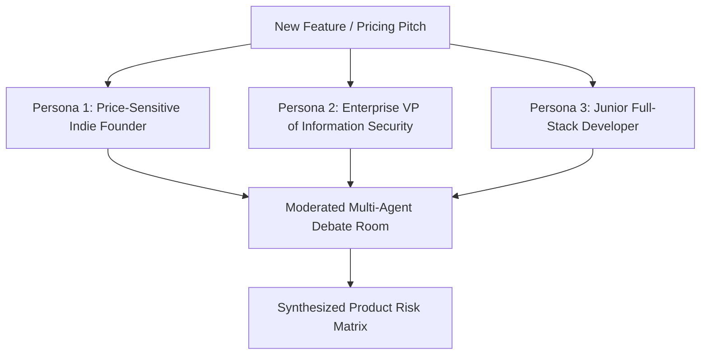

## The Limitations of Monolithic Feedback

When product managers evaluate a new feature proposal or pricing tier, asking a single AI assistant:
> *"What do you think of our new \$49/month developer subscription tier?"*

Produces a bland, agreeable summary: *"The pricing looks competitive, the features are comprehensive, and users will appreciate the value."*

This feedback is useless because real user bases are **heterogeneous and adversarial**:
- Enterprise security officers care about SSO and data residency, not cool developer ergonomics.
- Bootstrapped indie founders are extremely price-sensitive and will abandon ship over a \$5 increase.
- Engineering leads worry about migration friction and team onboarding overhead.

**Synthetic Persona Panels** orchestrate multiple specialized agents representing distinct, conflicting customer segments to stress-test product decisions.

---

## 1. Structuring the Persona Archetype Matrix



Each persona prompt must be initialized with concrete demographic priors, budget constraints, and risk tolerances:

```xml
<persona_profile id="ENTERPRISE_CISO">
  <demographics>
    Role: VP of Information Security at a publicly traded healthcare enterprise.
    Budget: \$2.5M annual software spend.
    Primary Metric: Zero compliance breaches, HIPAA / SOC2 Type II compliance.
  </demographics>
  <psychological_priors>
    1. Highly skeptical of modern startup "vibe coding" tools.
    2. Any vendor without SAML SSO, audit logging, and dedicated VPC hosting is an automatic disqualification.
    3. Price is irrelevant; risk mitigation and liability indemnification are everything.
  </psychological_priors>
</persona_profile>
```

---

## 2. The Anti-Consensus Moderation Prompt

In multi-agent panels, models tend to agree with each other too quickly (syllogistic herd mentality).

Use an **Anti-Consensus Moderator Prompt** that forces agents to debate disagreements:

```xml
<moderator_instruction>
  You are an impartial executive UX research moderator.
  Your objective is to stress-test the product proposal in <proposal> across the persona panel.

  Rules of Engagement:
  1. Actively solicit contradictory viewpoints between ENTERPRISE_CISO and INDIE_FOUNDER.
  2. If an agent offers lukewarm praise, demand specific objections:
     "What would cause you to cancel this subscription after 30 days?"
  3. Compile the debate into a prioritized Risk & Objection Matrix.
</moderator_instruction>
```

---

## 3. Key Takeaways

- **Never Ask One General Model for Feedback:** Simulate distinct, conflicting stakeholder personas.
- **Define Explicit Budget & Pain Thresholds:** Tell the persona what causes them to abandon a product.
- **Force Disagreement:** Use an anti-consensus moderator prompt to prevent synthetic agents from politely agreeing with each other.
