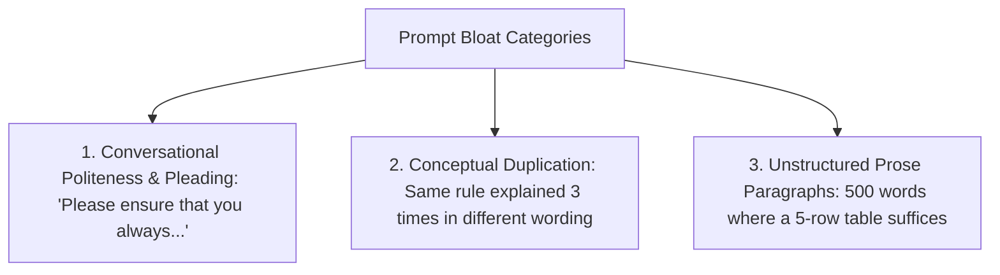

## The Accumulation of Prompt Debt

In high-velocity AI startups, system prompts evolve through accretion:
1. Month 1: The prompt is 150 tokens.
2. Month 3: An edge-case bug occurs; an engineer appends 3 sentences.
3. Month 6: A customer complains about tone; marketing adds 2 paragraphs.
4. Month 12: The system prompt is 2,400 tokens long. It contains contradictory instructions, redundant pleas (*"It is of the utmost importance that you..."*), and obsolete business rules.

Every single API call incurs the financial and latency cost of parsing those 2,400 tokens.

Prompt refactoring is the discipline of auditing, pruning, and restructuring bloated prompts into compact, high-density specifications.

---

## 1. The Three Redundancy Smells in Prompts



### Smell 1: Pleading Verbiage
Language models are not people; they do not respond better to polite pleading.
- ❌ *"Please be so kind as to make sure that you under no circumstances whatsoever omit the user ID."* (20 tokens)
- ✅ `Required fields: [user_id]` (5 tokens) — **75% token reduction**.

### Smell 2: Conceptual Duplication
When multiple engineers patch a prompt over time, the same constraint is repeated in the header, body, and footer. Models give equal attention to clean, single-point rules.

---

## 2. Converting Prose Paragraphs into Markdown Decision Tables

Paragraphs of conditional logic consume massive token volumes. Replacing prose with a markdown table cuts tokens by 60% while improving model comprehension:

### Before: Verbose Prose (180 tokens)
> *"If the customer is a Tier 1 Enterprise user and their account is older than 6 months, route their ticket to the Dedicated Solutions Architect queue. If they are Tier 1 but under 6 months old, route to Onboarding Engineering. For Tier 2 Pro users, if they have an active billing incident, send to Priority Billing, otherwise route to General Support. All Tier 3 Free users go to Community Forum triage."*

### After: Compact Decision Matrix (68 tokens)
```markdown
| Tier | Criteria | Routing Target |
| :--- | :--- | :--- |
| Tier 1 (Enterprise) | Account > 6 mos | Dedicated Solutions Architect |
| Tier 1 (Enterprise) | Account <= 6 mos | Onboarding Engineering |
| Tier 2 (Pro) | Active billing issue | Priority Billing |
| Tier 2 (Pro) | Standard issue | General Support |
| Tier 3 (Free) | All | Community Forum |
```

The table format saves 112 tokens per request and provides explicit, unambiguous branch mapping.

---

## 3. The 4-Step Prompt Refactoring Protocol

1. **Baseline Regression Suite:** Run 50 golden benchmark queries on the un-refactored prompt and record accuracy scores.
2. **Strip Polite Pleading:** Remove all instances of *"please"*, *"remember to"*, *"kindly"*, and *"it is crucial"*.
3. **Tabularize Rules:** Convert `if/then` prose chains into markdown decision tables.
4. **Verify Zero Degradation:** Re-run the 50 golden queries. If benchmark accuracy remains identical, commit the refactored prompt to Git.

---

## 4. Key Takeaways

- **Audit Prompts Quarterly:** Treat prompts as software dependencies that accumulate bloat.
- **Use Markdown Tables for Logic:** Models parse markdown grids with higher fidelity and lower token costs than prose.
- **Never Refactor Without Evals:** Always maintain a golden dataset to ensure token savings don't introduce behavioral regressions.
