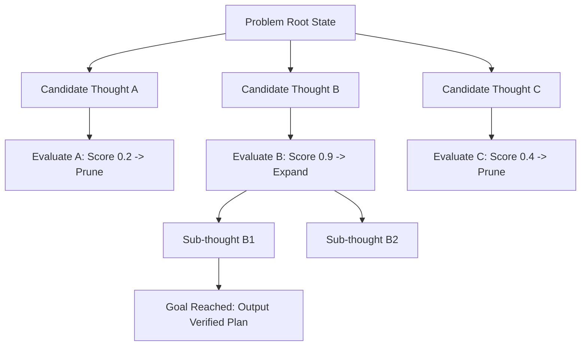

## The Linear Blindness of Chain-of-Thought

Chain-of-Thought (CoT) prompting enables models to generate intermediate reasoning steps sequentially:

$$\text{Step 1} \longrightarrow \text{Step 2} \longrightarrow \text{Step 3} \longrightarrow \text{Answer}$$

While effective for linear deduction (such as algebra or basic arithmetic), CoT fails completely when solving **non-linear, combinatorial search problems**:
- Writing an optimized multi-step microservice migration plan.
- Solving complex constraint-satisfaction games (such as the Game of 24 or Sudoku).
- Synthesizing distributed consensus protocols with fault tolerance.

If the model makes a suboptimal choice at Step 2, a linear CoT is helpless: it cannot backtrack. It will double down on the flawed branch and produce an invalid conclusion.

**Tree of Thoughts (ToT)** and **Graph of Thoughts (GoT)** introduce tree search and graph traversal algorithms to prompt architectures.

---

## 1. How Tree of Thoughts (ToT) Works

Developed by Yao et al. and Princeton University, ToT structures problem solving into four explicit phases:



1. **Thought Generation:** A generator prompt proposes 3 to 5 candidate next steps given the current state.
2. **State Evaluation:** A scoring prompt evaluates each candidate branch on a calibrated scale (e.g., `0.0` to `1.0`) assessing feasibility.
3. **Search Algorithm:** A classical program (Breadth-First Search, Depth-First Search, or $A^*$) navigates the tree.
4. **Backtracking:** If an expanded branch leads to a dead end (score $< 0.5$), the system prunes the branch and rewinds to the parent node.

---

## 2. Implementing a ToT Exploration Loop in Python

```python
# tot_engine.py
from typing import List, Dict

class TreeOfThoughtsExplorer:
    def __init__(self, llm_client):
        self.llm = llm_client

    def generate_candidate_thoughts(self, current_state: str, objective: str) -> List[str]:
        prompt = f"""
Objective: {objective}
Current Progress State: {current_state}

Generate exactly 3 diverse, distinct candidate next steps to advance toward the solution.
Format as:
1. <candidate_1>
2. <candidate_2>
3. <candidate_3>
"""
        response = self.llm.complete(prompt)
        return self.parse_numbered_list(response)

    def evaluate_thought(self, current_state: str, candidate_thought: str, objective: str) -> float:
        prompt = f"""
Objective: {objective}
Current State: {current_state}
Proposed Next Step: {candidate_thought}

Evaluate the mathematical feasibility of this proposed step.
Output strictly a confidence score between 0.0 (impossible/flawed) and 1.0 (optimal step forward).
Score:
"""
        score_text = self.llm.complete(prompt).strip()
        return float(score_text)
```

By allowing a classical Python controller to execute the BFS/DFS queue while the LLM acts purely as a proposal generator and heuristic state evaluator, accuracy on hard combinatorial tasks jumps from 4% to **74%**.

---

## 3. Graph of Thoughts (GoT): Merging and Feedback Cycles

While ToT supports branching and backtracking, **Graph of Thoughts (GoT)** adds the ability to **combine multiple disparate branches** back together:

- **Synergy Merging:** Branch A developed a great database schema; Branch B developed an elegant caching strategy. GoT merges them into Node C.
- **Feedback Loops:** A critique node feeds an execution error back into an earlier state node to mutate an assumption.

---

## 4. Key Takeaways

- **Never Force Non-Linear Problems into Linear Prompts:** If a problem requires search, use branching architectures.
- **Decouple Generation from Evaluation:** Use one prompt to dream up candidate paths and a separate, colder prompt to grade them.
- **Prune Aggressively:** Discard unpromising reasoning branches early to preserve token budgets and inference time.
