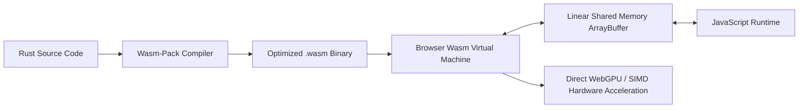

## The Limits of Client-Side JavaScript

JavaScript is the undisputed language of the web, but for compute-intensive tasks—image manipulation, audio spectrogram processing, vector mathematics, and machine learning inference—it struggles against physical constraints:
- JavaScript is dynamically typed and garbage-collected, introducing unpredictable stop-the-world pauses.
- Complex math loops suffer from JIT de-optimization and overhead compared to native compiled machine instructions.
- Processing a 50MB audio recording in pure JS can lock the browser main thread and freeze the UI.

**WebAssembly (Wasm)** changes this completely: a compact binary instruction format that allows languages like **Rust, C++, and Go** to run in browser sandboxes at near-native execution speed.

---

## 1. WebAssembly Architecture & Memory Model

Unlike JavaScript objects allocated on a managed heap, WebAssembly operates on a linear, contiguous byte array (`WebAssembly.Memory`):



Because Wasm code compiles ahead-of-time to machine instructions and supports 128-bit SIMD (Single Instruction, Multiple Data), vector operations and numerical calculations execute up to $20\times$ faster than equivalent JavaScript.

---

## 2. In-Browser ML Inference with Transformers.js & ONNX Runtime

One of the most transformative applications of Wasm is **Zero-Server Client-Side Machine Learning**.

Using WebAssembly and WebGPU, you can run embedding generation and speech-to-text models directly inside the user's browser:

```typescript
// client/in-browser-embeddings.ts
import { pipeline, env } from '@xenova/transformers';

// Configure to use WebAssembly with SIMD acceleration
env.backends.onnx.wasm.simd = true;

export async function generateLocalEmbedding(text: string): Promise<Float32Array> {
  // 1. Download and cache ONNX weights locally in browser CacheStorage
  const extractor = await pipeline(
    'feature-extraction',
    'Xenova/all-MiniLM-L6-v2',
    { quantized: true } // 4-bit quantized model (< 25MB)
  );

  // 2. Run inference locally on device (0 cloud API calls!)
  const output = await extractor(text, { pooling: 'mean', normalize: true });
  return output.data as Float32Array;
}
```

### Why This Matters for Unit Economics

If your web application has 100,000 active users searching their local notes:
- **Cloud Vector Embeddings API:** 100,000 users $\times$ 20 queries/day = 2,000,000 API calls/month = \$1,500/month in cloud bills.
- **Client-Side Wasm Embeddings:** 0 cloud calls. \$0/month cloud bill. 100% offline privacy for users.

---

## 3. Rust to Wasm: High-Performance Image Processing

Building a custom Wasm module in Rust is frictionless with `wasm-bindgen`:

```rust
// src/lib.rs
use wasm_bindgen::prelude::*;

#[wasm_bindgen]
pub fn apply_gaussian_blur(pixels: &mut [u8], width: u32, height: u32, radius: f32) {
    // Highly optimized multithreaded SIMD convolution filter in pure Rust
    // Mutates pixels directly in linear shared memory with 0 copy overhead
}
```

In the browser:
```typescript
import init, { apply_gaussian_blur } from './pkg/image_processor.js';

await init();
const imageData = ctx.getImageData(0, 0, width, height);
apply_gaussian_blur(imageData.data, width, height, 4.5);
ctx.putImageData(imageData, 0, 0);
```

---

## 4. Key Takeaways

- **Shift Compute to the Client:** Use WebAssembly for local transformations to eliminate backend server costs.
- **Leverage SIMD and WebGPU:** Enable 128-bit vector instructions to maximize throughput on modern CPUs and GPUs.
- **Guarantee Complete Offline Privacy:** In-browser models ensure user data never leaves their local device.
